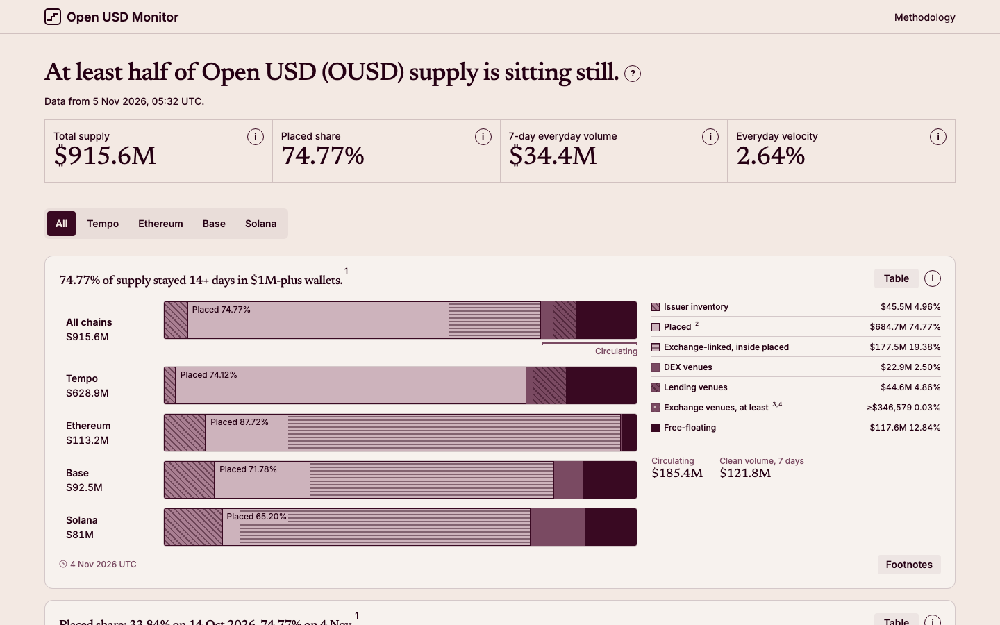
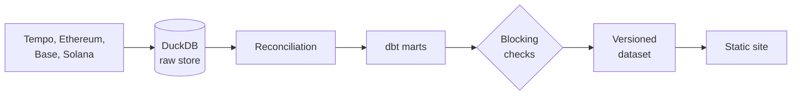

# Open USD Monitor

[](https://github.com/sajanrajdev/ousd-monitor/actions/workflows/ci.yml)
[](LICENSE)

An independent public dashboard that asks one question: is Open USD (OUSD) supply turning into money that moves? OUSD is a stablecoin issued by Bridge for Open Standard, and supply that its partners place is not the same as demand. This project reads public chain data on Tempo, Ethereum, Base and Solana, checks that its own numbers add up, and shows how much supply is placed, how much sits with venues, and how much of the transfer volume is everyday activity.



**Independent.** Not affiliated with Open Standard, Bridge or any partner. Not financial advice, and not an attestation: it says nothing about the reserves behind OUSD, so read Bridge's own reports for that. [The methodology](docs/methodology.md) says what each number means and how far to trust it.

## See it

```sh
make demo
```

This builds the bundled sample dataset and serves it at <http://127.0.0.1:8000/>. It needs [uv](https://docs.astral.sh/uv/) and Node 22.12+ or 24, and no keys, no `.env` and no chain access. Every page says it is a sample. Set `DEMO_PORT` to use another port.

Live site: _link to follow once the site is public._

## How it works



Transfers are ingested to the chain tip, reconciled, modelled, checked and only then published. If any check fails, nothing new is published and the last good dataset is marked stale.

## What makes the numbers trustworthy

- **Exact integers.** Amounts stay as integers in base units from the chain to the dataset. Rounding happens only when a number is shown.
- **Reconciled to `totalSupply()`.** Each chain's transfer events must add up to the contract's supply, to the base unit.
- **Cross-checked against the issuer.** The four-chain total is compared with the total Bridge's API reports.
- **Blocking checks.** Seven checks run before every publish, and a failure stops it.
- **Immutable, versioned datasets.** Each release is a new folder with a manifest, never an edit in place.
- **Public label sources.** Every entity label records its public source and a confidence, and nothing is named by inference.

OUSD is identified by contract address, because the ticker also belongs to Origin Dollar.

## Run the pipeline

You need keyed RPC URLs for Base and Solana in `.env` (copy `.env.example`). Tempo and Ethereum use public defaults.

```sh
make check   # lint, types and tests for the pipeline and the site; no keys, no chain access
make run     # ingest, reconcile, model, check and publish to data/published/latest
```

[Operations](docs/operations.md) covers the order of the steps, the keys, the one-writer rule, the daily run, alerts, and backup and restore.

## Documentation

- [Methodology](docs/methodology.md): what each number means
- [Architecture](docs/architecture.md): the stack and the code layout
- [Operations](docs/operations.md): running, deploying and recovering
- [Roadmap](docs/roadmap.md): what is next
- [Lessons learned](docs/build-log.md): what went wrong, and what was fixed
- [Design system](docs/design-system.md): the visual system
- [Contributing](CONTRIBUTING.md) and [security](SECURITY.md)

## Licence

The code is MIT, in [LICENSE](LICENSE). The published dataset is CC-BY-4.0.
