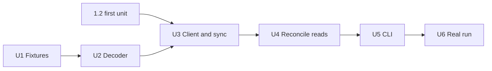

# feat: Add the Solana source (Phase 1, unit 1.3)

## Overview

Add `pipeline/ousd/solana.py`: read OUSD's movements at `finalized`, write them to the existing `transfers` table, reconcile them against `getTokenSupply` at a pinned slot, and check every wallet's balance with one call.

**The plan needs no schema change, no migration and no edit to `store.py`, `chains.py`, `sources.py`, `http.py`, `reconcile.py` or `.env.example`.** The only existing source module it edits is `cli.py`. It also extends `tests/test_cli.py` and `tests/test_secrets.py`. So there is no foundation unit, and `data/ousd.duckdb` keeps its rows untouched.

**Cost:** at the provider's listed prices, a cold backfill is about 52,200 credits, 5.2% of a 1M monthly allowance, in about 3 hours. That needs no paid upgrade if the key is on the 1M tier. The RPC can't show the key's plan, so the maintainer confirms that before the real run (U6).

## Requirements trace

| Requirement | Where it's met |
|---|---|
| R1 ingestion, from first mint | U2, U3 |
| R2 idempotent backfill | U3 (key, conflict check, re-key guard, resume) |
| R3 reorg handling, by each chain's finality signal | U3 (`finalized` only, no reorg walker), U6 (stated in the build log) |
| R6 per-chain supply | U4, U6 |
| R6 sampled balances | U4 (every wallet, one call), U6 (real result) |
| R16 build log | U6 |
| S1 to S5 capture | U2 |
| S6 to S8 same store | U2 (row contract), U3 (re-runs) |
| S9 to S11 reconciliation | U4, U5 |
| S12 finality | U3 |
| S13, S15 history and cost | U3, and "Backfill cost" below |
| S14 limits | U2 (stops), U6 (recorded for 2.1 and 2.5) |
| S16 empty URL | U3, U5 |

## Scope boundaries

- No history crawl per token account, no program interpretation, no batching or concurrency, and no reorg repair beyond the manual `Store.rollback_to`.
- No wallet-selection or Bridge rules. Unit 1.4 owns those.
- No fixtures from a provider's enhanced APIs. Standard JSON-RPC only.

### Deferred to other units

The Phase 2 plan puts two things "in the same change as" this unit. Neither can land here, because `dbt/` and `labels/` don't exist on `dev` yet:

- **Solana-shaped netting and balance tests** belong to units 2.4 and 2.5, built from this plan's `transient_account` and `version_1` fixtures.
- **Solana label rows** (redemption route, mint recipient, pool) belong to unit 2.3, or wherever `labels/` lands first.

See "Changes the binding docs need".

## What was measured

Read-only probes on the evening of 2026-11-03 local time (2026-11-04 UTC), about 2,200 credits on the key and about 100 keyless requests to the public RPC. Nothing here required a backfill.

| Fact | Result |
|---|---|
| Mint | Owner is Token-2022 (`TokenzQdBNbLqP5VEhdkAS6EPFLC1PHnBqCXEpPxuEb`), 6 decimals |
| Mint extensions | `mintCloseAuthority`, `permanentDelegate`, `defaultAccountState`, `confidentialTransferMint`, `transferHook` (program null), `metadataPointer`, `pausableConfig`, `tokenMetadata`. No transfer fee, confidential mint and burn, or scaled amount |
| Supply read | `getTokenSupply` at `finalized` returned `context.slot` and a string amount, for example 465132228 and `79670718246640` |
| Signature history | 53 pages to walk the whole list: 52,542 signatures, 428 failed, 52,114 to fetch. 10 seconds |
| Order | Strictly descending by slot, then `transactionIndex`, across all rows |
| **Second walk** | A full keyless walk of the public RPC about 2 hours later returned the same 52,542 rows in the same order, with the same `transactionIndex` and failure flag, and no late row below the first walk's head |
| Creation | The oldest row, `5w8xF6Bz...`, slot 414759955, 2026-04-21, holds `initializeMint`. A page requested before it is empty |
| Earliest sampled OUSD mint | Slot 415382345, 2026-04-24, 1 OUSD. The first sample includes the earliest 60 successful transactions |
| `transactionIndex` | Present on every signature row and on `getTransaction`, from both the key's provider and the public RPC. It matched `getBlock` signature order on all 6 rows checked, in 4 slots. Unique within a slot in all 51,280 slots. Largest value 3369 |
| Shared positions | 1,092 slots hold 2 or more successful transactions. In a sample of 20 such slots, all 20 had a pair with the same instruction position, for example slot 463296214 at outer index 1 |
| **First sample, 498 transactions** | Targeted, not uniform: the earliest 60 and newest 40 successful, 340 uniform random, 20 same-slot pairs and 20 failed. Failures are 4% of it against 0.8% of history. 478 succeeded |
| **Second sample, 1,518 transactions** | Uniform: every 34th successful signature |
| Versions, both samples | 1,276 legacy, 696 version 0, 44 version 1 |
| Balance invariant (S4) | A throwaway decoder held on all 1,996 successful transactions |
| Unseen cases | None in the 1,518 uniform rows: no plain `transfer` on OUSD, no partially decoded instruction naming the mint, no owner change and no confidential instruction. **Any single unseen case is below about 0.2% of history at 95% confidence, which is still up to about 100 transactions** |
| Mints and burns | 90 `mintToChecked` and 52 `burnChecked`, all inner. Each had one matching instruction on the second mint `ordRfw9q3nTSK5DR2H9o1SA6TtL3HRzAMKVXQsigayp`, which stays unnamed. No plain `mintTo` or `burn` |
| Transfers | 2,333 `transferChecked`, 1,162 top level and 1,171 inner. None by the permanent delegate in the first sample |
| Failed transactions | OUSD `transferChecked` instructions are recorded inside failed ones, for example one inner, in `5uwsKpkx...` |
| Transient accounts | About 1 in 8 transactions has a leg through an account with no token balance entry. In both samples, an `initializeAccount3` inside the same transaction resolved every one |
| Instruction positions | Largest flattened position 49 |
| **Whole-mint balance read** | One `getProgramAccounts` call on Token-2022, with `withContext` and filters on the mint at offset 0 and account type at offset 165: 8,310 accounts at one slot, 5.95 MB, 1.1 s. **The balances summed to exactly the supply read 5 slots later.** The same call with an owner filter works on the public RPC |
| **Every token account** | 8,310 of 8,310 have `transferHookAccount` and `pausableAccount`, 8,308 have `immutableOwner`, and none has `confidentialTransferAccount`. Closed accounts can't be checked this way |
| Mint coverage of transfers | 12 token accounts, 235 recent successful signatures: 6 weren't on the mint's list, and none moved OUSD. They were `closeAccount` calls |
| Token-2022 rule | `process_transfer` returns `MintRequiredForTransfer` when the source has `TransferHookAccount` or `PausableAccount` and no mint is given (`program/src/processor.rs`, `solana-program/token-2022`). The creation transaction initializes both extensions on the mint |
| Version 1 error | Asking at version 0 returns JSON-RPC error `-32015`, "Transaction version (1) is not supported" |
| Slot floor error | `minContextSlot` above the node's slot returns `-32016` with `data.contextSlot`. At the pinned slot it succeeds |
| Confidential instructions | None on OUSD. Real ones exist on other mints in October and November 2026 (see fixtures) |
| Latency and limits | One at a time at a 0.125 s interval: 5.08 and 5.27 per second achieved over 1,518 and 498 requests, with 67 and 25 getting 429 and `Retry-After: 1`, and 0 failed for good |
| Batches | 5 and 10 items succeed. 25 and 50 get 429, and 100 got 429 on 6 attempts running |
| Public RPC | Served all 13 fixture transactions. The 9 with a copy from the key had identical transaction, balances, inner instructions and `transactionIndex`. It refuses `getTokenLargestAccounts` (429) |

**A throwaway check through the real `Store`:** rows built with the key below from 12 real movements wrote without conflict, including the shared-position pair, and `minted_and_burned` returned the fixture amounts with no code change.

## Key technical decisions

### The row key

**Keep `PRIMARY KEY (chain, block_number, log_index)`. On Solana, `block_number` is the slot and `log_index` is `(transactionIndex << 12) | position`,** where `position` is the instruction's place in the transaction's flattened execution order: each outer instruction, then its inner ones. The source raises if `position` reaches 4096 or `transactionIndex` reaches 2^19. Together they fit the existing `INTEGER` column.

| Option | Verdict |
|---|---|
| **Encode the block position (chosen)** | No store change and no migration. `log_index` means what it does on EVM: unique in the block and in execution order. Phase 2's `order by block_number, log_index` gets true chain order, and its uniqueness test holds |
| Change the key to `(chain, tx_hash, log_index)` | What the architecture's wording says, but it rebuilds a table holding hours of fetched rows for no gain. It also removes the EVM guard that a different transaction at one position raises, so it would need a per-chain exception to keep that |
| Rank transactions by signature within the slot | Needs no store change, but its order means nothing and it depends on the complete set in the slot. `transactionIndex` is real and is already in the response |
| A separate Solana table | Breaks "everything after sources works on normalized rows" |

This wasn't known to earlier drafts: signature rows and `getTransaction` now carry `transactionIndex`, and getting a position from `getBlock` would cost far more. A missing `transactionIndex` raises. The move to a transaction-based key stays possible later, because the encoded value is also unique within a transaction.

**Re-key guard.** The key depends on `transactionIndex` staying stable. If it ever changed for a stored transaction, `_refuse_conflicts` would see a new position, not a conflict, and store the movement twice. A duplicated plain transfer leaves supply unchanged. So before each commit, `sync_solana` reads the stored `log_index` set for each signature in the batch, and raises `StoreConflict` if it exists and differs from the decoded set.

### How it fits the existing code

| Existing piece | EVM assumption | Solana |
|---|---|---|
| `sync_chain` | `eth_chainId`, tip, block hashes, ascending ranges | Not used. `sync_solana` is its own short path, and returns the same `SyncResult` with `tip` and `finalized` both set to the head slot and no reorg fork |
| `Chain` and `load_chains` | `chain_id`, `max_log_range`, `reorg_lookback` | Not used, as those fields would mean nothing. `SolanaChain` and `load_solana` live in `solana.py`, so `chains.py` isn't touched. `REQUIRED_CHAINS` already lists `solana` |
| Chain identity check | `eth_chainId` | `getGenesisHash` must equal mainnet's `5eykt4UsFv8P8NJdTREpY1vzqKqZKvdpKuc147dw2N9d`, so a devnet URL can't look like a quiet chain |
| `Store.write_range` | Commits rows, hashes and cursor together | Used as is, with `block_hashes={}` |
| `_refuse_conflicts` | Missing hash isn't a difference | Used as is, plus the re-key guard above. All Solana hashes are `None` |
| `block_hashes`, `prune_blocks`, `blocks` | Reorg window | No Solana rows and no calls |
| `rollback_to` | Reorg repair | Not called. Still works by hand, by slot |
| `minted_and_burned` | Zero address | Used as is. Mint rows are from `ZERO_ADDRESS`, burn rows to it. `0x...` can't be a base58 address, since base58 has no `0`, so an account owned by any real address can't be mistaken for a mint or burn. This is the Phase 2 contract |
| `record_reconciliation` | Block number | Used as is, with the pinned slot |
| `RpcClient` | `eth_*` methods | Not used. `SolanaRpc` wraps `PoliteClient` the same way. A JSON-RPC error on HTTP 200 can echo the URL or key, so its text goes through `PoliteClient.scrub`, from unit 1.2's first unit |

### Cursor and walking

`synced_through` keeps its meaning: every successful transaction at or below this slot is stored. Signature lists run newest first, but the cursor must only cover a contiguous range from the start. So each run:

1. Picks a head: `through_slot` if given, otherwise `getSlot` at `finalized`. If the cursor is already at or past the head, it returns.
2. Walks backward from the newest signature with `limit` 1000, `commitment` `finalized` and `minContextSlot` set to the head. That rejects a node whose slot is below the head. **It doesn't prove the node's signature index is complete up to the head,** which is why step 5 and the balance check exist. It retries `-32016` up to 5 times, 2 s apart, and keeps rows above a lower bound and at or below the head.
3. Stops at a row at or below the lower bound, or at the creation signature. **A short page proves nothing**, as the build log learned from Blockscout. An empty page before one of those stops raises, so truncated history fails before anything is written (S13). It also raises if rows aren't strictly descending by slot and `transactionIndex`.
4. Fetches the rest oldest first, skipping rows with `err` set, and commits whole slots through `write_range` at least every 200 transactions. Each commit's cursor is the last complete slot. The last commit sets the cursor to the head, even with no rows.
5. Uses a lower bound of the cursor minus `REREAD_SLOTS` (2,000 slots, about 13 minutes, about 20 transactions at current volume). This is the build log's healing lesson: re-read below the cursor, whatever the tip is. The window is a guess: the second walk found no late row, but it only looked about 2 hours later. A gap outside the window doesn't heal, but the balance check reports it. On a cold start there is no lower bound.

A null `getTransaction` result gets the same bounded retry as `-32016`, then raises. A signature listed by one node may not have reached another yet.

**The walk checks its endpoint and its order, not that no row is missing in the middle.** A hole holding only transfers wouldn't change supply. Two independent walks agreed row for row, and the balance check covers this on every reconcile. A signature ledger table was considered and rejected: it adds a table to guard something the balance check already reports.

### Backfill resume after a crash

No side table. Rows and cursor commit together, so a crash loses at most 200 transactions, about 40 seconds. A restart walks only from the head down to the cursor, at most 53 requests, then continues. Re-running at any point is safe, and killing the process is safe.

If the crash lands inside a re-read, the cursor may sit a little lower than before. It stays true, because everything below it is stored.

### Backfill cost

**It fits a 1M tier at listed prices, with no paid upgrade. The key's actual plan is unverified, so U6 starts with the maintainer confirming it.**

| Item | Requests | Credits |
|---|---|---|
| Signature walk | 53 | 53 |
| `getTransaction`, skipping 428 failed | 52,114 | 52,114 |
| Checks and supply | About 5 | 5 |
| **Total** | **About 52,200** | **About 52,200, or 5.2% of 1M a month** |

- **Credit prices** are from the provider's credits page: `getTransaction` and `getSignaturesForAddress` are 1 credit, other standard reads are listed as 1, and `getProgramAccounts` is listed as 10. The page shows no date.
- **We can't see the key's plan, its remaining credits or actual charges** from the RPC. The 429 pattern fits the Free tier's 10 requests a second. Whether 429s are charged isn't stated. If they are, add about 5%.
- **If real prices were 10 times the list,** the backfill alone would fit at about 522,000, but the first month with the running cost below wouldn't, at about 1.2M. U6's check of the first 1,000 transactions would show that before it matters.
- **Free tier overage** isn't documented, as a hard stop or otherwise.
- **Time:** about 2.85 hours at a `min_interval` of 0.125 s, from the 5.08 per second measured, including 429 retries. Budget 3.5. That rate was measured over 5 minutes, not sustained for hours. Volume grows by about 2,300 transactions a day (about 8 minutes). `ousd sync` holds the DuckDB lock for the run, so nothing else can sync then. Stopping and resuming is cheap if another chain's run must go first.
- **After the backfill:** about 2,300 credits a day, or 70,000 a month, at current volume.
- **Batching is rejected.** Batch items count against the limit, so 10 items a second is the most a batch could do, and 25 or more is refused outright. That's at most about 2 times faster, in exchange for per-item error handling. Retries already handle occasional 429s, and `PoliteClient` honors `Retry-After`.

### Supply reconciliation

`getTokenSupply` can't be read at a past slot, so:

1. **Pin.** Read `getTokenSupply` at `finalized`. Its `context.slot` is P, and its `value.amount` is the supply. Require `decimals` of 6.
2. **Sync through P** with `sync_solana(through_slot=P)`.
3. **Compare** `minted_and_burned("solana", P)` with the amount, and record it with `record_reconciliation`.

**If P is behind the cursor** (a lagging node), re-pin up to 5 times, 2 s apart. If it's still behind, the result is `Unchecked`. Recording it would fail the gate, which requires the row's block to equal the cursor.

**Anything that stops those steps returns `Unchecked(chain, reason)`, never a pass:** the read failing, `-32016` persisting, a stored-row conflict, a data stop from the decoder, truncated history, a database with no Solana cursor, or a tail longer than `MAX_TAIL_SLOTS` (100,000 slots, about 11 hours). Reconcile doesn't run a backfill, whether cold or partial, as that would hold the DuckDB lock for hours without warning. A failed comparison after a complete sync is a real `MISMATCH`, not unchecked.

**A supply match says nothing about transfers.** Mints and burns are about 6% of movements, so a supply `MATCH` alone leaves the rest unchecked.

### Balance check

One `getProgramAccounts` call returns every token account of the mint at one slot, for about 10 credits. That's the same order as supply, and better than a sample:

1. **Read.** All accounts, with their owner and amount, summed by owner, at the slot the response reports.
2. **Sync through that slot.**
3. **Compare** every owner with received minus sent at or below that slot, taken from `transfers`. A wallet in the rows but not in the read must net to 0, since a closed account has no entry. `ZERO_ADDRESS` is never a wallet.

This catches a missed plain transfer between any two wallets, which supply can't, unless a later movement exactly reverses it. It also surfaces a token account that changed owner, as the check fails. It doesn't explain why. A mismatch stays a fail until someone looks, and the row's token account isn't stored, so diagnosis uses the read's owner and a refetch of the affected transactions.

`read_sampled_balances` keeps the shape unit 1.4 planned for, and is built on this read. `owners=None` means every owner, which gives 1.4's `--census` for Solana in one call.

**Fallback if a provider refuses the call:** `getTokenAccountsByOwner` per owner, at its own slot. Not built now.

### Decoding

- **Fetch:** `getTransaction` with `encoding` `jsonParsed`, `commitment` `finalized`, `maxSupportedTransactionVersion` 1. A future version errors loudly (`-32015`), and raising the constant is a deliberate change.
- **Movements:** `mintToChecked`, `burnChecked` and `transferChecked` with `program` `spl-token` and `info.mint` equal to the mint. Amounts come from `tokenAmount.amount`, a string, never `uiAmount`.
- **Plain `mintTo` and `burn`** aren't decoded: 142 of 142 sampled were `Checked`. If one appears, it changes a balance with no decoded movement, so the invariant stops the sync and names the signature, which becomes a real fixture.
- **Plain `transfer`** isn't decoded. It carries no mint. **The invariant can't catch one that isn't on the mint's signature list, because that transaction is never fetched.** Coverage rests on Token-2022 rejecting it from accounts with these extensions, which every one of the 8,310 current accounts has, and on the balance check if that ever fails.
- **Owners:** from the account's `preTokenBalances` or `postTokenBalances` entry, else its `initializeAccount`, `initializeAccount2` or `initializeAccount3` in the same transaction. If there's no owner, or pre and post owners differ, stop. These fail closed because a wrong owner would quietly corrupt wallet metrics.
- **Failed transactions** return no rows, checked on `meta.err` even though the walk skips them.
- **Balance invariant (S4):** per token account of this mint, the post amount minus the pre amount (0 if absent) must equal the decoded net. Any difference raises, naming the signature.
- **Confidential and unparsed instructions stop the sync.** Any parsed instruction whose type contains "confidential" and whose `info.mint` equals the mint raises, except `initializeConfidentialTransferMint` and `updateConfidentialTransferMint`. So does any partially decoded Token-2022 instruction whose accounts include the mint. The invariant alone wouldn't catch these, as a confidential transfer moves no public balance, and S5 says not to understate quietly. An allowlist of every known type was rejected, because each harmless unseen type would stop the backfill.
- **`blockTime` and `transactionIndex`** must be present. `tx_hash` is `transaction.signatures[0]`, as is.

### Errors

Two types, both raised by `solana.py`:

- `SolanaRpcError`, with the JSON-RPC `code`: the node returned an error, including `-32015` and a persisting `-32016`.
- `SolanaDataError`: anything else that makes the data untrustworthy. The balance invariant, owners, confidential or unparsed instructions, limits on the key, missing `blockTime` or `transactionIndex`, a wrong genesis hash, truncated or out-of-order history, a null `getTransaction` after retries, and a fetched slot or index differing from its signature row.

Messages hold the signature, program, instruction type and index, never on-chain text such as memos. Provider text in `SolanaRpcError` goes through `scrub`, with control characters stripped and a cap of 200 characters.

### Configuration

- `load_solana(env)` strips `SOLANA_RPC_URL`. Unset, empty and blank are the same, and there is no public default.
- A selected chain with no key exits 2 before the store opens, naming the variable and never a value. **`ousd sync` or `ousd reconcile` with no `--chain` counts as selecting Solana**, so both keys are needed for a full run, and `--chain tempo` still works with neither. This is unit 1.2's rule, enforced by the `missing_rpc_keys` and `KEYED_RPC_ENV` it adds, which it maps to `solana`. This plan adds no second check. A partial sync that looks successful is the failure R6 exists to prevent.

### Where the reconcile logic lives

`reconcile_solana` and the balance functions are in `solana.py`, following the "small Solana path" rule, and matching unit 1.4's plan, under which `reconcile.py` never imports `solana.py`. They decide a published check, though, and the protected-path rule only names `reconcile.py` by path.

**So U4 is treated as protected by hand: the same handling and extra review as `reconcile.py`.** That isn't enforced by tooling. Enforcing it means the owner adding a path to `security_sensitive_paths`, and it's reported as a decision for the coordinator.

## Implementation units



**Foundation units: none.** Nothing here changes a path that another unit builds on. Every unit is fully typed for `make check`'s mypy, including `warn_return_any`: values from JSON go through `int()` or `str()` before they're returned. Tests follow the `conftest.py` network ban, and use a fake that subclasses the real client, as `FakeRpc` does.

**Schedule:** unit 1.2's first unit must merge before U3 starts, and the coordinator confirms that order. U6's run needs about 3.5 hours, so it should start during 2026-11-04 to leave room for one stop and its fix before 2026-11-05.

- [ ] **U1. Capture the fixtures**

**Goal:** real JSON for every edge case, before any code depends on it.

**Requirements:** success criterion "every edge case has a test using real captured JSON".

**Dependencies:** none.

**Files:**
- Create: `tests/fixtures/solana/*.json`, as listed below
- Create: `tests/fixtures/solana/README.md`, listing each file's method, parameters, capture date and endpoint

**Schema or migration:** none. **Real key:** no. Capture from the public `https://api.mainnet-beta.solana.com` at one request every 2 seconds, retrying on 429. `.env` is never read. The capture script isn't committed.

**Approach:** store each response's `result` verbatim as pretty JSON, with `encoding` `jsonParsed`, `commitment` `finalized`, `maxSupportedTransactionVersion` 1. Don't edit, trim or anonymize any file. Mutations for negative tests happen in memory inside tests. About 170 KB in total. Before committing, list every memo and metadata `uri` string in the files, and confirm none holds personal data or names a partner.

| File | Method and argument | Why |
|---|---|---|
| `mint_inner_second_mint.json` | `getTransaction` `3bcNbfSDoDGX25DfYpwWrE2Z5WKZw2EKTdMCf8sLnjPMKuTeH3zDEH9NKe5TZFKZNCfguEGac4KeTvM5RG8gHgio` | Inner mint, with the second mint moving in the same instruction |
| `burn_inner_second_mint.json` | `getTransaction` `5N1276YqFMhu8oHxmUt8uK7HZ1cVmCdEjnnpfG7DgN6WUoiSWQxFRwnVozFPsuFxATBJG7oPp6D3ka6Z2evab9xk` | Inner burn, same shape |
| `failed_inner_move.json` | `getTransaction` `5uwsKpkxjtW4RV3UHNEREVip1YvUpkfmBxvNQpGXQTrbDQw7s72MZDkhBF4BhQ9NwEfxW124VJA2i9WvWTLRhZDv` | Failed, with an OUSD inner instruction recorded |
| `version_1.json` | `getTransaction` `3mcZGRsHsd7QPyHoGUzv6hCfo3rAKxZ7Ym3T5W4xM9TtEqEWzaTmsE8UMGSQynw3wkCT1R9L7EZT8xjMfisitLUs` | Version 1, with 3 inner transfers |
| `version_0_inner.json` | `getTransaction` `D4rsdZfkmdstKBgpeo5SdVKgAJ9Dtrebh29Yx323uu7dvjBwKF3fzJGjbGNJQLXt7ZLnDa35LWaQfvC1zkuZRw5` | Version 0, inner transfer |
| `shared_position_a.json`, `shared_position_b.json` | `getTransaction` `4RWC94UKCbJf2ev9b9A7cNABN2qxaeL3uGku3Nd1wp8T3vqGfFeKGZFUnwtJPYMP228PzgqfYt8MaqRNvAGDksZh`, `52Vo1pMd2uawLk7TbGNggDhG3k3D32xPM16THuNy6rKKUrXhF8cZXBqsEfQ2cN8M8dEHVEG4xqJJHH1pDGKUzJmJ` | Same slot, same instruction position |
| `transient_account.json` | `getTransaction` `3mM4LwzwtTxcwh5eyqpJbGZxhfHBkdLRg53soRFXTpAa7xZa7RQAXQjop9PWMqXU3FTPpZKaSsAHhZ3eBm8yew4W` | Account created and closed inside the transaction |
| `top_level_transfer.json` | `getTransaction` `3FXYo3fvVRepJazMGgwgEZ9zouurccDbUs39vvAwi8MMe9QnbxnUYwUtK6n8Dw9zS5gK1dvNU7VzRuyDDjpWUyFS` | Simple transfer |
| `no_movement.json` | `getTransaction` `3Xqq4SHeTZNkrHxgVnTAsBhNiBKpndpqHxBzuR3hQJwSm7bogZPkorq8Nn6XHsADUNumB1Djnjq8QRycoj8StPM1` | Names the mint, moves nothing |
| `mint_creation.json` | `getTransaction` `5w8xF6Bzj9UNkMyBWUPDAeUwTZtqECMXg5do4S19gthAC6JR7JSyrmUhN3VyrfBB6rvsJT4kBzejsvtRUTz5AcbW` | Creation, with every extension's initialize instruction |
| `confidential_deposit_transfer.json` | `getTransaction` `63wKxJ254UT832pB3jSbgfzJwSY5CjNETi1LwXvSzLKTE9tDY3a3JN1gTgJJ2xyRpZ4GnpvzfPH5f9ZMsfJGEZ7F` | **Another mint**, `C76grNg6a957CNBzFnBPjSTBxx1Dx2t1kwUokqBrnwDM`. Deposit and transfer, version 1 |
| `confidential_withdraw.json` | `getTransaction` `3YM38ogmcFP2unpDiEdWhDKbK2KEsdweytRW1AmYS666JkSWzU4CrXgcPeDGKh9hkX38oNWi7dsgZQe7Cd7D5R5d` | **Another mint**, `4XiALZXT8jG9zH8JCJXkc8iRQshR7U3X1rtadEmd6q6d`. Withdraw |
| `mint_account.json` | `getAccountInfo` the OUSD mint | Token-2022 mint extensions |
| `token_account.json` | `getAccountInfo` `EjLgtKu5s4q9ifSEVUvypiSsa9ZifCtNefXNZyR2yitd` | Token account extensions |
| `token_accounts_one_owner.json` | `getProgramAccounts` on Token-2022 with `withContext`, memcmp filters: offset 0 the mint, offset 32 `DpqFuc9Ce2Frn8dMvz8aVZoF1HusRr9gfALrtafG9x4X`, offset 165 `3` | Real shape of the balance read. The whole-mint response is about 6 MB, so one owner stands in for it |
| `token_supply.json` | `getTokenSupply` the OUSD mint | `context.slot` and string amount |
| `block_time.json` | `getBlockTime` slot 463296214 | Unit 1.4 needs the pin's time |
| `signature_page.json` | `getSignaturesForAddress` the OUSD mint, `limit` 3, `before` `2E8WdNXrJNXejKbahJk4mrTb8yfxmWyM5ZKbNY4NMyStB36UdPG8vnzzqFAhCJ7399HhX63uCnFR2qmcZHL1GDmm` | Three rows, the first failed |
| `signature_page_before_creation.json` | `getSignaturesForAddress` the OUSD mint, `limit` 5, `before` the creation signature | Empty page |
| `error_min_context_slot.json` | The whole JSON-RPC body of `getSignaturesForAddress` with `minContextSlot` far above the current slot | `-32016` shape |
| `error_unsupported_version.json` | The whole JSON-RPC body of `getTransaction` on the `version_1` signature at version 0 | `-32015` shape |

**The confidential fixtures are real, but from other mints,** because OUSD has none in either sample, and no current OUSD account is configured for them. The decoder takes the mint as an argument, so the test runs on real JSON unchanged. If the real backfill finds one on OUSD, it stops there and U6 records it, and that signature becomes a fixture in the follow-up change.

**Test expectation:** none, as this unit adds data only. U2 to U4 fail if any file is wrong.

**Verification:** every file parses, none is empty, and no file contains an RPC endpoint or `api-key`. On-chain metadata `uri` values are expected, and stay. A check of the listed slots and transaction indexes against the table in U2 passes.

---

- [ ] **U2. Decode a transaction into rows**

**Goal:** the pure function at the heart of the source, with S1 to S7 and S14's stops enforced.

**Requirements:** S1, S2, S3, S4, S5, S6, S7, S14.

**Dependencies:** U1.

**Files:**
- Create: `pipeline/ousd/solana.py`, with the decoder and `SolanaDataError` only
- Create: `tests/test_solana_decode.py`

**Schema or migration:** none. **Real key:** no.

**Approach:** `decode_transaction(transaction, mint)` returns `list[Transfer]`, following "Decoding" and "The row key" above. Unit 1.4 also calls it directly. The module docstring states the row contract and why `block_hash` is `None`.

**Patterns to follow:** `pipeline/ousd/decode.py`: a frozen `Transfer`, and rejecting anything that isn't the token.

**Test scenarios**, all on real fixtures, with `MINT` the OUSD mint unless stated:

| Fixture | Expected |
|---|---|
| `mint_inner_second_mint` | One row: slot 459708395, `log_index` 475140 (index 116, position 4), from `ZERO_ADDRESS`, to the owner starting `Hmc2dLxZ`, value 30315020000. No row for the second mint |
| `burn_inner_second_mint` | One row: slot 456218249, `log_index` 3338242 (815, position 2), from the owner starting `3ZGf3ERi`, to `ZERO_ADDRESS`, value 4917380000 |
| `failed_inner_move` | No rows, though it holds an OUSD inner `transferChecked` |
| `version_1` | Three rows of 66383778, positions 19, 21 and 24, in execution order |
| `version_0_inner` | One row, position 6, value 1051836175 |
| `shared_position_a` and `_b` | Slot 463296214, values 800000000 and 10000000, `log_index` 1085441 and 1093633: same position, different keys |
| `transient_account` | Three rows of 490832379. The middle owner, starting `BQ72nSv9`, comes from the `initializeAccount3`, as that account has no balance entry |
| `top_level_transfer` | One row, position 1, value 100000. Addresses keep their case |
| `no_movement`, `mint_creation` | No rows and no error |
| `confidential_deposit_transfer` with mint `C76g...` | Raises `SolanaDataError` naming the signature and the instruction |
| `confidential_withdraw` with mint `4XiA...` | Raises the same |
| Both confidential fixtures with `MINT` | No rows. Another mint's instructions are ignored |

- **Invariant, mutated in memory:**
  - Remove the movement instruction from `top_level_transfer` -> raises, naming the signature.
  - Change its post balance by one base unit -> raises.
  - Change a `transient_account` inner amount so the transient account no longer nets to zero -> raises.
  - Rename `mintToChecked` to `mintTo` in `mint_inner_second_mint` -> raises, as it's no longer decoded.
- **Owners, mutated in memory:**
  - Remove the `initializeAccount3` from `transient_account` -> raises rather than guessing.
  - Give an account different pre and post owners -> raises.
  - Set the destination's owner in `top_level_transfer` to the mint address -> stays a transfer, and `minted_and_burned` doesn't count it.
- **Instructions, mutated in memory:**
  - A confidential type not in the fixtures, naming the mint -> raises.
  - `initializeConfidentialTransferMint` in `mint_creation` -> doesn't raise.
  - Replace an instruction with a partially decoded Token-2022 one whose accounts include the mint -> raises. The same without the mint -> ignored.
- **Fields:**
  - Missing `transactionIndex` or `blockTime` -> raises.
  - `transactionIndex` of 2^19, or a position of 4096 -> raises rather than overflowing.
  - Largest allowed index and position -> the value fits a signed 32-bit integer.
- **Assumptions on chain:** `mint_creation` holds `initializeTransferHook` and `initializePausableConfig`. `mint_account` has no transfer fee or confidential mint and burn. `token_account` has `transferHookAccount`, `pausableAccount` and `immutableOwner`. These pin the facts the plain-transfer reasoning rests on.
- **Store contract:** writing rows from `shared_position_a` and `_b` through a real in-memory `Store` -> two rows, and writing them again changes nothing. `minted_and_burned` for the mint and burn fixtures -> (30315020000, 4917380000).

**Verification:** every fixture has a passing test. The decoder is pure, with no client or store imports beyond `Transfer` and `ZERO_ADDRESS`.

---

- [ ] **U3. Client, chain config and sync**

**Goal:** a resumable, finalized-only sync through the existing store.

**Requirements:** R1, R2, R3, S8, S12, S13, S15, S16.

**Dependencies:** U2, and unit 1.2's first unit for `PoliteClient.scrub`. Don't copy `_scrub` to work around the order.

**Files:**
- Modify: `pipeline/ousd/solana.py`
- Create: `tests/solana_fakes.py`, used by U3 and U4
- Create: `tests/test_solana_sync.py`
- Modify: `tests/test_secrets.py` (created by unit 1.2)

**Schema or migration:** none. **Real key:** no. Tests use a fake.

**Approach:**
- `SolanaChain`: frozen, `name="solana"`, `mint`, and `rpc_url` with `repr=False`, as `Chain` does.
- `load_solana(env)`: see "Configuration".
- `SolanaRpc(http, url)`: `genesis_hash`, `finalized_slot`, `signatures(mint, before, min_context_slot)`, `transaction(signature)`, `block_time(slot)`, `token_supply(mint)` returning `SlotReading(slot, amount)`, and `token_accounts(mint)` returning `BalanceSnapshot(slot, balances)`, with `balances` summed by owner.
- `token_accounts` uses the filters in U1, and raises if any row isn't parsed as an `account` of this mint.
- `sync_solana(chain, rpc, store, through_slot=None)` returns `SyncResult`, following "Cursor and walking" and "Errors". Constants: `MINT_CREATION_SIGNATURE`, `SIGNATURE_PAGE = 1000`, `COMMIT_EVERY = 200`, `REREAD_SLOTS = 2_000`, `RPC_INTERVAL = 0.125`.
- It checks each fetched transaction's slot and `transactionIndex` against its signature row, and applies the re-key guard before each commit.
- It logs progress at each commit, with no URL.

**Patterns to follow:** `pipeline/ousd/ingest.py` for logging and `SyncResult`, `tests/conftest.py` `FakeRpc` for the fake, `tests/test_sources.py` `httpx.MockTransport` for client tests.

**Test scenarios**, with `FakeSolanaRpc(SolanaRpc)` serving real fixtures and pages built from their real fields:

- **Cold run, happy path:** history ending in `mint_creation` -> all rows stored, cursor at the head, oldest first, one `getTransaction` per successful signature.
- **Failed rows:** a failed signature row -> no `getTransaction` for it.
- **Truncated history:** pages that end empty without the creation signature -> `SolanaDataError`, and nothing written on a cold database.
- **Short page:** a page of 3 rows followed by more -> the walk continues and misses nothing.
- **Out-of-order page:** rows not descending by slot and index -> `SolanaDataError`.
- **Resume:** fake raises on the Nth `getTransaction` -> the cursor stays at the last committed slot, and a second run stores the rest with row count equal to an uninterrupted run. The second run requests no signature below the re-read bound.
- **Commit boundary:** 3 transactions in one slot straddling `COMMIT_EVERY` -> the cursor never lands on a slot with a transaction missing.
- **Re-run:** a second sync with nothing new -> same rows and cursor, at the head.
- **Re-read heals:** a signature inside `REREAD_SLOTS` below the cursor that an earlier page omitted -> the next sync stores it.
- **Conflict:** a re-read that returns a different amount -> `StoreConflict`, and nothing from that batch is stored.
- **Re-key:** a re-read of a stored signature with a shifted `transactionIndex` -> `StoreConflict`, and no second row.
- **`through_slot`:** rows above it aren't stored, and the cursor equals it. If it's at or below the cursor, there are no requests beyond the check.
- **`minContextSlot`:** sent as the head on every signature page. `-32016` twice then success -> sync completes. `-32016` persisting -> `SolanaRpcError` after 5 retries, with the fixture's real error body.
- **Wrong chain:** another genesis hash -> `SolanaDataError` before any other request, and nothing written.
- **Null transaction:** null then success -> sync completes. Null persisting -> `SolanaDataError`, and the cursor doesn't pass it.
- **Row mismatch:** a fetched slot or index differing from its signature row -> `SolanaDataError`.
- **Client, through `MockTransport`:**
  - Sends `maxSupportedTransactionVersion` 1, `jsonParsed` and `finalized`.
  - `-32015` becomes `SolanaRpcError` with that code.
  - `token_supply.json`, `block_time.json` and `token_accounts_one_owner.json` parse to the real slot and integer values.
  - A row in `token_accounts` for another mint -> raises.
- **Secrets, in `tests/test_secrets.py`:** with the key in a path and in a query value, a 401 whose body echoes the URL and an HTTP 200 JSON-RPC error holding the bare key both raise with no URL or key in the message. `repr(SolanaChain)` hides the URL.
- **Config, parametrized:** `load_solana` with the variable unset, empty and blank gives the same empty value, and none raises.

**Verification:** no test touches the network, and a mid-run failure at any point leaves a cursor that's still true.

---

- [ ] **U4. Supply and balance checks**

**Goal:** the honest comparisons, and what 1.4 needs. **Same handling and extra review as `reconcile.py`.**

**Requirements:** R6, S9, S10, S11.

**Dependencies:** U3.

**Files:**
- Modify: `pipeline/ousd/solana.py`
- Create: `tests/test_solana_reconcile.py`

**Schema or migration:** none. Uses the existing `reconciliations` table. **Real key:** no.

**Approach:**
- `Unchecked(chain, reason)`: frozen. Unit 1.4 moves it to `reconcile.py`.
- `reconcile_solana(chain, rpc, store)` returns `ChainReconciliation | Unchecked`, following "Supply reconciliation". It catches only `HttpError`, `SolanaRpcError`, `SolanaDataError` and `StoreConflict`. A programming error still raises. Unchecked results aren't written to `reconciliations`, whose columns can't hold them. Reasons go to 1.4 through the return value.
- `read_sampled_balances(chain, rpc, store, owners)` returns `list[BalanceReading] | Unchecked`, with `BalanceReading(owner, slot, amount)`. It takes one `token_accounts` read, syncs through its slot, and returns the given owners, or every owner when `owners` is `None`. An owner with no account reads 0. An empty list returns `[]` with no requests.
- `check_all_balances(chain, rpc, store)` returns `BalanceCheck | Unchecked`, following "Balance check", with `BalanceCheck(chain, slot, wallets_checked, differences)` and a `matched` property. The model query runs on `store.db`, so `store.py` stays unchanged, and 1.4 can replace it with its `balances_at`. Nothing is recorded, because 1.4 adds the table.
- All three return `Unchecked` for no cursor, with "run sync first", or for a tail over `MAX_TAIL_SLOTS`, before any read.

**Patterns to follow:** `pipeline/ousd/reconcile.py` `reconcile_chain`, `ChainReconciliation`. Import the type from there. `reconcile.py` itself isn't edited, and must not import `solana.py`.

**Test scenarios**, with the fake from U3:

- **Supply match:** supply at P equal to stored events -> `ChainReconciliation` with `block_number` P, difference 0, and one row recorded.
- **Difference of 1 base unit** -> `matched` false, recorded, returned as a real mismatch and not as `Unchecked`.
- **Order:** the fake records calls -> the supply read comes before the sync, and the sync is through exactly P.
- **Rows above P:** a mint at P+1 in the fake doesn't count, and isn't stored.
- **Pin behind the cursor:** then a newer pin -> uses the newer one. Behind on every retry -> `Unchecked`, nothing recorded.
- **Each failure gives `Unchecked` with a reason, and nothing recorded:**
  - The supply read raises `HttpError`.
  - `-32016` persists during the tail.
  - A tail transaction fails the invariant.
  - Truncated history, a wrong genesis hash, or a null transaction during the tail.
  - `decimals` isn't 6.
  - A `StoreConflict` in the tail.
  - No cursor: says run sync first, with no reads or backfill.
  - A tail over `MAX_TAIL_SLOTS`: no `getTransaction` calls.
- **Programming error:** an unexpected `KeyError` propagates rather than becoming a soft result.
- **Secrets:** no `Unchecked.reason` holds the URL.
- **Balances:**
  - The read comes before the sync, and the sync is through the read's slot.
  - Stored rows matching every owner -> `matched`, and `wallets_checked` counts them.
  - A wallet off by one base unit -> `matched` false, showing the owner and both amounts.
  - A missed transfer between two wallets, with supply unchanged -> both wallets differ. This is the case supply can't see.
  - A wallet in the rows but absent from the read, netting 0 -> no difference. Netting non-zero -> a difference.
  - An owner with two token accounts is summed. `ZERO_ADDRESS` isn't treated as a wallet.
  - A row at a slot above the read doesn't count.
- **`read_sampled_balances`:** given owners -> only those, all at the read's slot. `None` -> every owner. An unknown owner reads 0. `[]` -> no requests. A failed read or tail -> `Unchecked`.
- **Sequence:** balances, then supply -> the recorded row's block equals `synced_through`.

**Verification:** `reconcile_solana` has no code path from a failed pin or a failed tail to a `ChainReconciliation`. Whether a later publish can still pass on an older row is a question for the caller, and is covered under "Exposes to 1.4".

---

- [ ] **U5. Wire the CLI**

**Goal:** `--chain solana` works for `sync` and `reconcile`.

**Requirements:** S10, S16, and the success criteria.

**Dependencies:** U4, and unit 1.2's key check in `main`.

**Files:**
- Modify: `pipeline/ousd/cli.py`
- Modify: `tests/test_cli.py`
- Modify: `README.md` (the sentences unit 1.2 leaves saying Solana is pending, and the key description)

**Schema or migration:** none. **Real key:** no.

**Approach:**
- `main` builds `available: dict[str, Chain | SolanaChain]` from `load_solana()` and `load_chains()`, **with Solana first**. A cold or lagging Solana sync is the slowest, and Ethereum's state must still be recent when reconcile reads it, as the build log records.
- `_sync` and `_reconcile` take `Sequence[Chain | SolanaChain]`, since `list` is invariant and `tests/test_cli.py` passes `list[Chain]`. Each branches on `isinstance(chain, SolanaChain)`. Keep each branch to a few lines, as 1.2 and 1.4 change the neighbouring code.
- The `_reconcile` branch runs `check_all_balances`, prints it, then runs `reconcile_solana`, in that order. Balances first leaves the supply row at the cursor. It prints up to 10 differences and the total count.
- Unchecked prints `solana: UNCHECKED: <reason>` and makes the exit non-zero. Its absence from `results` keeps `solana` in Bridge's missing list.
- `--at-block` with Solana is a parser error: `getTokenSupply` has no past-slot read.
- The README states the key's meaning on Solana.

**Test scenarios**, through `cli.main` or `_reconcile` with monkeypatched functions, as `tests/test_cli.py` does:

- `--chain solana sync` calls `sync_solana` once and prints the head slot.
- `--chain solana reconcile`, both matched -> exit 0 from existing logic, prints `MATCH` for supply and for balances, with their slots.
- A supply mismatch -> exit 1. A balance mismatch with supply matching -> exit 1, showing the wallet.
- `Unchecked` from either check -> exit 1, prints the reason, never `MATCH` for that check. The other check still prints.
- With supply `Unchecked`, the Bridge comparison lists `solana` as missing.
- `--chain solana` with `SOLANA_RPC_URL` unset, empty or blank -> exit 2, naming the variable, for both commands, with no database file. Use `monkeypatch.delenv` and `setenv` so `.env` never matters.
- No `--chain` with `BASE_RPC_URL` set and `SOLANA_RPC_URL` empty -> exit 2 naming `SOLANA_RPC_URL`.
- `--chain tempo` with no Solana key -> runs, and never builds a Solana client.
- No `--chain`, all keys set -> Solana syncs first.
- `--chain solana reconcile --at-block 5` -> exit 2.
- A failure in `-v sync` with a URL holding a marker string -> the marker isn't in stdout, stderr, the log output or the exception.

**Verification:** existing CLI tests pass unchanged.

---

- [ ] **U6. Real backfill and reconcile**

**Goal:** the real result, recorded honestly.

**Requirements:** R1, R6, R16, and the success criteria.

**Dependencies:** U5 merged to `dev`, `SOLANA_RPC_URL` in the primary checkout's `.env`, no other sync running, and the maintainer's confirmation below.

**Files:**
- Modify: `docs/build-log.md`
- Modify: `README.md` if the status line is now wrong

**Schema or migration:** none. New rows only, all with `chain = 'solana'`.

**Real key and real run:** yes. **Maintainer first:** read the key's plan, remaining credits and overage setting from the provider's dashboard, and confirm it has at least 60,000 credits and no paid overage. Then the coordinator runs these from the primary checkout, one at a time, without a pipe:

```sh
# Backfill. About 3 hours, about 52,200 credits. Resumes if interrupted. Logs a line per commit.
# After about 1,000 transactions (about 4 minutes), the maintainer can compare the dashboard's
# usage with the count. Stop if it's far above 1 credit per transaction.
uv run --locked --env-file .env ousd -v --chain solana sync

# Reads every wallet, pins supply, syncs the tail, compares. About 30 credits.
# Must print MATCH for balances and for supply, each with a difference of 0 base units.
uv run --locked --env-file .env ousd --chain solana reconcile

# Idempotence. The stored count must not fall, and new rows can only be new activity.
uv run --locked --env-file .env ousd -v --chain solana sync
uv run --locked --env-file .env ousd --chain solana reconcile
```

`--chain` and `-v` go before the subcommand. `reconcile` alone isn't a substitute for the backfill: on an empty database it reports unchecked. If unit 1.4's CLI has landed by then, a matching single chain exits 3 rather than 0, so read the printed lines.

**Approach:** record in `docs/build-log.md`:
- The pinned slot, the amounts, the wallet count, the row count, the run time, any 429 count and the credits the dashboard shows.
- That Solana has no reorg test, because it's finalized-only: nothing to simulate, and no walker.
- The key decision, closing the log's "Revisit with Solana".
- The S14 limits, for units 2.1 and 2.5.
- Any stop or mismatch, as it is. **Don't adjust data to fit.** A `SolanaDataError` names its signature: add that transaction as a fixture and a test in a follow-up change. An owner change that fails a wallet stays a fail until the maintainer decides.

**Test expectation:** none, as this unit changes no code. Any bug it finds gets a test in its own fix.

**Verification:** the build log holds real numbers, and says plainly whether Solana reconciled. Phase 1's Solana line is done only with a printed `MATCH`, difference 0, **for both supply and every wallet**.

## Interfaces

### Assumes from 1.2 and 1.4

**From 1.2 (Base), its first unit, which lands before U3:**
- `PoliteClient.scrub(text, url)`. **It must remove a key from a query value as well as a path segment,** which 1.2's plan says it does, as a keyed URL may hold the key in either. U3's test covers both.
- `KEYED_RPC_ENV` with `solana` mapped to `SOLANA_RPC_URL`, and `missing_rpc_keys` as called from `cli.main`.
- `tests/test_secrets.py`.

These come from 1.2's plan as written on 2026-11-03 and aren't on `dev` yet. **If that unit changes,** U3 and U5 change with it, and this plan shouldn't build its own copies. Nothing else from 1.2 is needed.

**From 1.4 (reconciliation):** nothing to land first. Assumes `ChainReconciliation` keeps its fields and `record_reconciliation` its signature, which its plan confirms.

**From `dev`, verified in the code:** `Store.write_range`, `synced_through`, `minted_and_burned`, `record_reconciliation`, `transfer_count`, `Transfer`, `ZERO_ADDRESS`, `PoliteClient`, `HttpError`, `SyncResult`, `ChainReconciliation`, `compare_with_bridge` and `REQUIRED_CHAINS`. `kind`, `runners.py`, `reconcile_at` and `PENDING_CHAINS` don't exist, and nothing here uses them.

### Exposes to 1.2

- `chains.py` stays 1.2's alone. This plan leaves the Base entry and `Chain` as they are. `SolanaChain` is a separate type, which 1.2's name-keyed `KEYED_RPC_ENV` already allows.
- `chains.py`'s docstring says "Base and Solana are added here". 1.2 edits that docstring and should not repeat the claim for Solana.
- U5 finishes the README sentences 1.2 leaves saying Solana is pending.

### Exposes to 1.4

| Name in `ousd.solana` | Use |
|---|---|
| `reconcile_solana(chain, rpc, store) -> ChainReconciliation \| Unchecked` | The per-chain supply check. On a pass or a mismatch it's the same type as other chains, already recorded, with `block_number` the pinned slot |
| `read_sampled_balances(chain, rpc, store, owners) -> list[BalanceReading] \| Unchecked` | Balances for the given wallets, as 1.4 planned, now all at one slot. **`owners=None` reads every owner in one call, about 10 credits, so `--census` on Solana is cheap enough for every run** |
| `check_all_balances(chain, rpc, store) -> BalanceCheck \| Unchecked` | Every wallet against the rows. Used by U5 until 1.4 replaces it |
| `SolanaRpc.transaction(signature)`, `decode_transaction(transaction, mint)` | Callable on their own. `log_index` is the value stored |
| `SolanaRpc.block_time(slot) -> int` | The pin's time for the Bridge window, as 1.4 asked |
| `Unchecked(chain, reason)` | Solana couldn't be checked. 1.4 moves it to `reconcile.py`, and `solana.py` then imports it |
| `load_solana`, `SolanaRpc`, `SolanaChain` | To build the client |

**1.4 should know:**
- `reconcile_chain` doesn't take Solana. Dispatch happens outside `reconcile.py`, which must not import `solana.py`, as that would be an import cycle.
- Every Solana row's `block_timestamp` is `blockTime`, and never null. A missing one stops the sync.
- `compare_with_bridge` works as is, given only checked results: an `Unchecked` Solana appears in `chains_missing`.
- Reading balances moves the cursor past an earlier supply pin, so read balances first, or run supply again, as 1.4's "final supply reading" does.
- **A caller must treat `Unchecked` as not passed in a way that lasts.** `Unchecked` writes no row, so an older matched row can still sit at the cursor. Unit 1.4's run-level gate handles this: publishing needs the newest finished run to be `pass`. Don't let a publish step read `reconciliations` alone for Solana.
- A sampled Solana wallet must be an owner wallet, not a token account. `ZERO_ADDRESS` is never a wallet.
- A balance mismatch could mean a token account changed owner (S14). It should fail, not be explained away.
- 1.4 owns the final exit-code rules, and its U8 removes U5's `_reconcile` branch. Until then, U5's unchecked exits 1.

### Exposes to Phase 2

The row contract in `docs/plans/2026-11-03-001-insight-models-plan.md` holds as written. Also: `block_hash` is always `NULL`, `log_index` is opaque but ordered, and legs through temporary accounts name their real owner, so one route appears as several transfers. About 1 in 8 transactions has one, so unit 2.5's netting by transaction must be tested on this shape.

Unit 2.8's `sampled_balances` compares at `synced_through`, and Solana has no past-slot read. It should compare with 1.4's stored readings on Solana, as 1.4's plan proposes.

## Path overlaps

| Path | This plan | 1.2 | 1.4 | Conflict and order |
|---|---|---|---|---|
| `pipeline/ousd/chains.py` | Not edited | Adds Base, `KEYED_RPC_ENV`, `missing_rpc_keys`, edits the docstring | Not edited | None |
| `pipeline/ousd/cli.py` | U5: `available`, and a branch each in `_sync` and `_reconcile` | Key check in `main`, removes the `httpx` line | U8 rewrites `_reconcile`, and removes U5's branch | **High, same function.** Land 1.2, then U5, then 1.4's U8 |
| `pipeline/ousd/sources.py` | Not edited | Scrubs two messages | Adds reads | None |
| `pipeline/ousd/http.py` | Not edited, uses `scrub` | Its first unit adds public `scrub` | Not edited | None if that lands first. `PoliteClient`'s constructor and `request_json` must stay |
| `pipeline/ousd/store.py` | **Not edited, no migration** | Not edited | Adds tables and `balances_at` | None. `write_range`, `minted_and_burned` and `record_reconciliation` must keep their signatures, and `store.db` must stay reachable |
| `.env.example` | Not edited, as PR #5 added `SOLANA_RPC_URL` | Not edited | Not edited | None |
| `pipeline/ousd/solana.py` | New, U2 to U4 | None | U7: one import | Low, after this plan's U4. Units run in order, as they share the file |
| `pipeline/ousd/reconcile.py` | Not edited, imports `ChainReconciliation` | None | Owner | None if the fields stay |
| `tests/test_cli.py` | U5 adds tests | Likely | U8 changes expected exits | Moderate. Land before U8 |
| `tests/test_secrets.py` | U3 extends it | Creates it | Possibly | Low. Additive, after 1.2 |
| `tests/conftest.py` | Not edited | Possibly | Adds methods to `FakeRpc` | None. The fake lives in `tests/solana_fakes.py` |
| `README.md` | U5, U6 | Three sentences | U9 | Low |
| `docs/build-log.md` | U6 | Real run | Real run | Low. Append-only |

**Protected paths:** none of U1, U2, U3 or U5 touches `.env*`, `reconcile.py`, `publish.py` or `labels/**`. U4 doesn't either, but is treated as protected by hand. U6 reads `.env` to run the real backfill, in the primary checkout only.

## Changes the binding docs need

This plan doesn't edit them. The coordinator applies these or asks for them.

- **`docs/architecture.md`, Core data rules, idempotent writes:** "The key is chain plus transaction plus log index, or the Solana equivalent" matches neither chain's code. Replace with: "The key is chain, block or slot, and log index. On Solana, `log_index` is `(transactionIndex << 12) | position`, so it's unique in the slot and in execution order."
- **`docs/architecture.md`, Core data rules, reorgs:** add "Solana reads only `finalized`, so it stores no block hashes and has no reorg repair."
- **`docs/architecture.md`, Blocking checks, sampled balances:** add "On Solana, every wallet is checked, with one read at one slot."
- **`docs/architecture.md`, Security:** note that `reconcile_solana` and the balance checks in `solana.py` get the same review as `reconcile.py`. If that should be enforced, the owner adds a path to `security_sensitive_paths` in an `owner-config` PR.
- **`docs/implementation-plan.md`, unit 1.3 row:** paths should add `pipeline/ousd/cli.py`, `README.md`, `tests/fixtures/solana/` and `docs/build-log.md`.
- **`docs/PRD.md`, section 10:** "Solana history is untested" can become "Solana's full signature history was read on both the key and the public RPC, with the same rows."
- **`docs/plans/2026-11-03-001-insight-models-plan.md`:** the "same change as units 1.2 and 1.3" sentence and the "Solana shape" risk row name this unit for work that can't land here. Point them at units 2.3, 2.4 and 2.5, per "Deferred to other units".
- **`README.md`:** "a transfer's key is chain, block and log index" stays true. U5 adds the Solana meaning.

## Risks

| Risk | Response |
|---|---|
| `transactionIndex` isn't in the provider's published schema for `getSignaturesForAddress`, so it could change | It's in the responses from both the provider and the public RPC, and on `getTransaction`. A missing value raises, and a changed one trips the re-key guard. The fallback is `getBlock`'s signature order, at a higher cost, and would need a re-key of stored rows |
| The whole history doesn't reconcile | A real `MISMATCH`, reported as it is. Nothing publishes |
| A movement outside the samples trips a stop part way through the backfill | Commits are kept, the stop names the signature, and resume is cheap. Each new kind costs a follow-up change, and there's time for about one before 2026-11-05 |
| A missed transaction that doesn't change supply | The balance check reports it on every reconcile, unless later reversed exactly |
| A token account changes owner without naming the mint | Not visible to the sync. The balance check fails loudly. 8,308 of 8,310 current accounts have `immutableOwner` |
| Both sides of the check come from one provider | One provider could serve a wrong history and a matching supply. The signature list was confirmed once on the public RPC, and the assumption is recorded here |
| `getProgramAccounts` becomes refused or too large | `Unchecked`, never a pass. The fallback is per-owner reads, and a sample |
| Free tier limits change, or the key isn't on it | The maintainer's check before U6. At 5% of the allowance, a stop resumes next month at worst |
| A weakened check gets less scrutiny because it isn't in `reconcile.py` | Treated as protected by hand, stated in U4 and in the binding doc change, and reported to the coordinator |

## What couldn't be verified

- That the full history reconciles. Nothing fetched all 52,114 transactions, and the balance read hasn't been compared with rows.
- Actual credits charged, the key's plan, and whether 429s cost credits. The RPC doesn't report them.
- The provider's credit page has no date, and its pricing page was last updated in January 2025.
- Sustained rate. 5.08 per second held for 5 minutes, not 3 hours.
- Confidential instructions on OUSD. None were sampled, and no current account can do them, so those tests use real ones from other mints. Closed accounts can't be checked.
- `transactionIndex` beyond the 4 slots compared with `getBlock`. It's unique and ordered everywhere it was read, and both providers agree on every row.
- How late a signature can appear. None did across about 2 hours, on one comparison.
- The samples are 2,016 of 52,542 transactions. The invariant runs on all of them at sync time, which is why it stops rather than warns.

## Review findings

Reviewed for coherence, feasibility, adversarial cases, security and scope.

| Finding | Outcome |
|---|---|
| A supply `MATCH` leaves about 94% of movements unchecked | **Changed the plan.** Probed and added the whole-mint balance check, and made it part of "done" |
| A changed `transactionIndex` would duplicate rows silently | **Fixed.** Re-key guard in U3 |
| `Unchecked` leaves an older matched row for a later publish | **Resolved with 1.4.** Its run-level gate handles it, and the rule is under "Exposes to 1.4" |
| The walk can't prove no hole in the middle | **Tested and accepted.** A second, independent walk agreed row for row, and the balance check covers it. A signature ledger was rejected |
| `minContextSlot` overstated as proof of index freshness | **Fixed** the wording, and the window is stated as a guess |
| Balance sync moves the cursor past the supply pin | **Fixed.** Balances run first in U5, 1.4 re-reads supply, and a pin behind the cursor retries |
| The invariant was overstated as the plain-transfer backstop | **Fixed** the wording. All 8,310 accounts were then measured to have the extensions |
| Confidential stop was a short denylist | **Fixed.** Now any "confidential" type naming the mint, and any partially decoded one. An allowlist was rejected |
| The sample wasn't uniform, and its size wasn't justified | **Fixed.** Stated the method, added 1,518 uniform transactions, and stated the bound |
| Cost headline was unconditional, and the 10x hedge ignored running cost | **Fixed.** Conditional wording, a maintainer check and a usage check in U6 |
| Phase 2's "same change" items were dropped silently | **Fixed.** Deferred explicitly, with a binding doc change |
| Exception types didn't match the `Unchecked` promise | **Fixed.** "Errors" section, and U4's failure list |
| `list[Chain \| SolanaChain]` fails mypy on existing tests | **Fixed.** `Sequence` in U5 |
| "No file contains a URL" conflicts with verbatim metadata | **Fixed.** U1 now targets RPC endpoints and keys, and reviews memos and URIs |
| `reconcile_solana` escapes the path-based protection | **Recorded.** Kept in `solana.py` to match 1.4's plan, and reported to the coordinator as an owner decision |
| A reconcile could run a partial backfill for hours | **Fixed.** `MAX_TAIL_SLOTS` |
| A long Solana sync could age Ethereum's state before reconcile | **Fixed.** Solana syncs first |
| Plain `mintTo` and `burn` had no real fixture | **Fixed.** Dropped. 142 of 142 sampled were `Checked`, and the invariant stops on any other |
| Balance API had no caller or real fixture | **Fixed.** U5 calls it, U6 runs it, and U1 captures a real response |
| A null `getTransaction` at the tail would fail a run on brief lag | **Fixed.** Bounded retry |
| Error text could carry on-chain strings | **Fixed.** "Errors" section |
| No token accounts are stored, so diagnosing a wrong owner means a refetch | **Recorded.** Retaining raw JSON was rejected for now, as only 2 current accounts can change owner |
| Single-provider trust | **Recorded** under Risks |
| Time estimate didn't follow from its inputs, and small consistency fixes | **Fixed** |

## Sources

- Origin: `docs/brainstorms/2026-11-03-solana-source-requirements.md`
- Code on `dev`: `pipeline/ousd/store.py`, `ingest.py`, `reconcile.py`, `http.py`, `cli.py`, `tests/conftest.py`
- Lessons: `docs/build-log.md`, Phase 1
- Row contract: `docs/plans/2026-11-03-001-insight-models-plan.md`, "Solana contract"
- Companion plans: `docs/plans/2026-11-03-003-base-source-plan.md`, `docs/plans/2026-11-03-005-reconciliation-plan.md`
- Provider docs: `helius.dev/docs/billing/credits`, `/billing/rate-limits`, `/api-reference/rpc/http/getsignaturesforaddress`, and `helius.dev/pricing`
- Token-2022 program source: `github.com/solana-program/token-2022`, `program/src/processor.rs`
