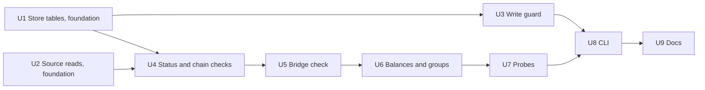

# feat: Full cross-chain reconciliation against Bridge (Phase 1, unit 1.4)

## Overview

`ousd reconcile` becomes the one command that says whether the numbers can be trusted. It runs blocking checks 1 to 3 from `docs/architecture.md` and records the result for `mart_reconciliation` and the publish gate. It exits 0 only when all four chains are checked and matched and Bridge agrees.

Today it can exit 0 with chains unchecked, the Bridge comparison can't fail anything, and sampled balances don't exist.

The main finding changes the shape of the Bridge check. **Bridge's response carries a `last_updated` time, and in the 3 of 5 snapshots that could be confirmed, its figure equals the chain sum at that time to the base unit.** So the check compares against our own event history around that moment, and requires an exact match. It does not need a wide amount tolerance to ride out movement.

## Requirement trace

| Requirement | Where |
|---|---|
| R6, per-chain supply to the base unit | U4, U7 |
| R6, sampled balances against `balanceOf` | U1, U2, U6, U7 |
| R6, chain total against Bridge within a stated timing tolerance | U1, U2, U5 |
| R2, idempotent writes | U3 |
| R3, reorgs | U1 (audit rows roll back with the data), and the gate's pin hash |
| R8, last good data on a failed check | The recorded result, read by the publish gate in unit 2.8 |
| Architecture blocking checks 1, 2, 3 | U4, U5, U6 |
| Build log: "deciding what counts as a full pass belongs to the cross-chain reconciliation unit" | U4, U8 |
| Build log: `logIndex` agreement unchecked, and Blockscout's lag gap | Measured below, U3, U6 |
| Project rule: filter by contract address | Every read passes the token address. Receipts and Blockscout logs are filtered by it again locally |
| Project rule: never publish a number that hasn't passed | The exit codes and the recorded status fail closed |

## Scope boundaries

- No dbt, Dagster or publish code. Those are units 2.6, 2.7 and 2.8, which read what this records.
- No automatic deletion or repair of raw rows. See "What happens if rows aren't real".
- No new environment variables, so `.env.example` doesn't change.
- Solana decoding, sync and reads belong to unit 1.3. This plan calls them.

## What was measured

All read-only, on 2026-11-04 UTC, against the public Tempo and Ethereum nodes, Blockscout, Bridge, and the Base and Solana keys. `data/ousd.duckdb` was not opened. Polling covered about 90 minutes, so these are a small sample, and the first week of real runs should be compared with them.

### Bridge

| Finding | Evidence |
|---|---|
| Response has `last_updated`, and it isn't used today | `{"last_updated":"2026-11-04T02:10:33Z","total_onchain_amount":"899941296.66664",...}` |
| A new snapshot about every 10 minutes | 02:10:33, 02:20:29, 02:30:36, then 03:20:31 and 03:50:33. Local polling stopped from about 02:48 to 03:20 when the local network dropped, so the gap is ours and not Bridge's |
| It reaches S3 30 to 38 s later, and the CDN can hold the old copy for about 5 minutes more | `last-modified` 02:21:04, still serving the old object at 02:25:23. Largest age served: 14 min 50 s |
| Equal to the chain sum to the base unit at `last_updated` | 3 of 5 snapshots: 02:10:33, 02:20:29, 02:30:36. EVM chains read at that time by block timestamp, Solana from the nearest poll |
| 2 of 5 can't be confirmed | Solana has no past-slot read. At 03:20:31 the implied Solana figure differs by 5 OUSD from a read taken later. At 03:50:33 no poll was close enough |
| When Bridge read the chains | At 02:30:36, EVM moves totalling -3,879.24 that had all landed by 02:27:38 (T-178 s) were included, and a +121.02 move between T and T+30 s was not. So that read came no earlier than about T-223 s and before T+30 s. At 03:50:33, a move after T+30 s was excluded. This is thin evidence, and each chain may be read at a slightly different moment |

### Real movement

The width is the highest minus the lowest supply inside a window, for a window starting at each minute. Tempo covers 2,405 mints and burns over 47.2 days. Ethereum covers 128 over 1.33 days only. Base and Solana weren't measured this way.

| Window | Tempo: no movement | p95 | p99 | max | Ethereum: no movement | p95 | p99 | max |
|---|---|---|---|---|---|---|---|---|
| 2 min | 94.1% | 2 | 20,007 | 81.3M | 89.7% | 55,691 | 1.94M | 5.06M |
| 5 min | 87.2% | 2,162 | 172,105 | 81.3M | 81.3% | 804,695 | 3.30M | 5.52M |
| 10 min | 79.0% | 16,481 | 940,440 | 94.9M | 70.5% | 1.94M | 5.06M | 5.52M |
| 30 min | 60.2% | 116,457 | 9.67M | 125.5M | 47.1% | 5.00M | 5.52M | 5.52M |
| 60 min | 47.0% | 474,564 | 15.0M | 140.0M | 31.9% | 5.52M | 6.09M | 6.09M |

So comparing a live chain read with a Bridge figure up to 15 minutes old with an amount tolerance has two faults. A real burst fails it, and a gap of up to 2.25M passes it.

### Ethereum's pruned-state limit, on the public node

| Read | Served | Refused |
|---|---|---|
| `eth_call` by block **number** | 100 blocks back | 110 back, HTTP 403 "Archive requests require a personal token" |
| `eth_call` by block **hash** | 10,000 back | 15,000 back, as a JSON-RPC error |
| `eth_getTransactionReceipt` | 15,000 back | 50,000 back, returns null |

The hash reads are real state. Around a mint 9,977 blocks back, supply by hash moved by exactly that mint. So number reads stop between 100 and 110 blocks back, and hash reads, which reconciliation already uses, go much deeper. None of this is documented, so the plan doesn't rely on it.

Base's key returned receipts 10,000,000 blocks back and Tempo's public node returned one at its first mint. Base's state also read at 1,000,000 blocks back.

### Same-looking transfers

"Same-looking" means the same transaction, sender, receiver and value at different log positions. A scan of Tempo from block 40,000,000 to the tip found exactly the 6,496 groups reported, across 367,829 rows, 204,829 transactions and 1,960 wallets.

| Groups | Shape | Evidence they are real |
|---|---|---|
| 6,490 groups of 4, in 3,245 transactions | One batch transaction (type `0x76`, 8 calls): wallet A to B four times, then B to A four times, then the fee. 2 wallets, blocks 45,067,784 to 46,332,088 | 40 of 40 random receipts list the same positions, at non-adjacent indexes, with status success and 9 logs. The 2 transactions inspected have 8 calls. Across one block, each wallet's balance change equals the model's net (-51 for the fee payer, 0 for the other) |
| 6 groups of 2, in 2 transactions | One multi-hop route, 37 logs, value 0.000001 OUSD | Both receipts list exactly the stored positions |

These are real, on the evidence so far. Their extra rows add 242.9M OUSD of headline value, which Phase 2's same-transaction netting already removes.

**A balance check can't prove these.** Each loop nets to zero between its two wallets, so deleting three rows from each side leaves every balance unchanged. Only the receipt tells them apart, so the check below uses receipts and treats balances as extra evidence.

Ethereum's 6 groups weren't seen: they fall outside the last 10,000 blocks, which held none, and listing them needs the local database. See "Owner actions" in the PR.

### Blockscout `logIndex` against RPC

Blocks 26,328,433 to 26,336,414, read from both: 754 rows, **identical in position, transaction, addresses, value and timestamp**, including 143 blocks and 135 transactions with more than one log. Blockscout's per-transaction REST endpoint returned the same 8 positions as RPC for one transaction, and returns `block_hash` and `index`. Its limit is separate: 180 seen, with a reset of about 22 s, against about 10 per 30 minutes on the `getLogs` endpoint sync uses.

No mismatch exists in this range. A standing guard is still warranted, because a future Blockscout change would otherwise store duplicates silently.

## Key technical decisions

### What a full pass is

Three statuses, for each check, each chain and the whole run: `pass`, `fail`, `unchecked`.

| Level | `pass` | `fail` | `unchecked` |
|---|---|---|---|
| **Chain** | Supply matched exactly at a final pin equal to the cursor, every sampled balance matched, every wallet touched since the sample was read matched, every same-looking group through the pin is proven real, and any census it requires is complete | A proven disagreement after the one resync: supply, a balance, a group that isn't real, or `StoreConflict` | Anything that couldn't be read or finished: no cursor, a failed sync, state refused, group proof unavailable, an incomplete sample, a missing census, a pin that can't reach the cursor |
| **Bridge** | An exact match under the rule below, on any attempt | Compared and unmatched on at least one attempt, with no attempt matching | Never compared: API down, malformed, stale, or chains not all passed |
| **Run** | Scope is all of `REQUIRED_CHAINS`, all four `pass`, and Bridge `pass` | Any chain or Bridge is `fail` | Everything else, including any `--chain` or `--at-block` run |

| Exit | Meaning | When |
|---|---|---|
| 0 | Full pass | Only the `pass` row above |
| 1 | Fail, or a crash | A proven mismatch. An uncaught programming error also exits 1, and leaves the run row unfinished, so it can't read as a pass |
| 2 | Usage or configuration | `argparse` errors and a missing key, per unit 1.2's rule. Nothing is recorded |
| 3 | Unchecked | Nothing is proven wrong, but something wasn't checked |

Exit 3 is new and separate from 1, because they call for different responses: rerun later, or stop and investigate. A subset that matches prints `MATCH` for that chain, ends with `RESULT: UNCHECKED`, and exits 3.

`make reconcile` hides the difference, because `make` exits 2 for any failed recipe. Use the `uv run` command in "The real full run" when the code matters. The Makefile doesn't change.

One chain being unchecked doesn't stop the others, so a failure can't hide what the rest found.

### The Bridge check

**Rule.** Fetch Bridge's snapshot at the start of the attempt, before any chain is synced. Let T be `last_updated`. For each chain, collect its supply after every block with a mint or burn in `[T-300 s, min(T+60 s, pin time)]`, plus its supply just before that span. The check passes if Bridge's figure equals, exactly, one value from each chain added together. This is integer arithmetic over the set of attainable sums.

**Tolerance, stated for the methodology page:** Bridge's figure must equal our four-chain total to the base unit, taking each chain's supply at some block from 5 minutes before to 1 minute after Bridge's own timestamp. There is no amount tolerance. The tolerance is only in time.

**Why these numbers.** The evidence puts Bridge's read no earlier than about T-223 s and before T+30 s, from one bracket. T-300 s is the earliest edge the offsets support, and T+60 s adds a margin. A wide window costs little here, because a pass still needs an exact match. Each comparison records, per chain, the block time it matched at, so the first week of runs can tighten both constants from data.

**What it proves, and doesn't.** It proves four things together: the four chains are the whole supply Bridge reports, we read the right contracts, the chains were read near that time, and our events reach the same total. Blocking check 1 proved each chain's events equal `totalSupply` at the pin. That proves only the total through the pin, so events can't be claimed correct at each earlier moment: a lost mint and an equal lost burn, both before the window, pass both checks. Bridge's figure also appears to come from the same contract state, so this isn't independent evidence about history. The methodology page must say so.

**Why supply comes from events.** It is the only way to reach a past time on Solana, and it treats all four chains alike.

**Too many combinations.** If the attainable sums would exceed 1,000,000, the attempt is `unchecked` with `bridge_window_too_busy`. At the measured event rates this shouldn't happen.

**Attempts.** Up to 3, 10 minutes apart, and any pass counts, as the architecture says. Only a Bridge result other than `pass` retries. Each retry repeats the top-up sync, the supply check, the wallets-touched read and the group audit through the new pin, so a final pin never holds unchecked rows. The first-attempt sample isn't read again. An attempt that sees a T already compared isn't counted: it waits 60 s and refetches, up to 5 times, then is `unchecked` with `bridge_same_snapshot`. Chains that aren't all `pass` end the run with no retry.

**Failure handling:**

| Situation | Result | Reason |
|---|---|---|
| API error after `PoliteClient`'s retries | `unchecked` | `bridge_unavailable` |
| Anything malformed: `last_updated` missing, or not RFC 3339 with `Z` or an offset; a total that doesn't match plain decimal digits, so `NaN`, `Infinity`, exponents and signs are refused; a body that isn't an object | `unchecked` | `bridge_malformed` |
| `last_updated` more than 60 s ahead of our clock at fetch | `unchecked` | `bridge_malformed` |
| Snapshot older than 30 minutes at fetch | `unchecked` | `bridge_stale` |
| A chain's pin time is before T, or can't be read | `unchecked` | `coverage_gap` |
| Any chain not `pass` | `unchecked` | `chains_not_passed`, with the difference printed for information |
| Compared and unmatched, with no attempt matching | `fail` | `bridge_mismatch` |

30 minutes is three update cycles, and the largest age seen was under 15. A frozen feed would still match history, so a stale one must not count as agreement. An outage therefore blocks publishing, and the site keeps its last good data, which is the architecture's rule.

### Sampled balances

For each chain, the model balance is received minus sent through the pin. It is compared exactly with the chain's balance.

| Stratum | Wallets | Why |
|---|---|---|
| `top` | 20 by model balance, ties by address | A lost row matters most here, and it matches unit 2.8's count |
| `random` | 30 | Coverage, including wallets now at zero |
| `delta` | Every wallet touched in rows above the height the sample was read at, through the final pin, read at the final pin | So a final pin later than the sample holds no unchecked wallet |
| `census` | Every wallet, when asked or required | See below |

**Reproducible.** The seed is `v1|<chain>|<UTC date>`. Candidates are every address in `transfers` through the pin, excluding `ZERO_ADDRESS`. `random` takes the lowest `sha256(seed + "|" + address)`. No `random` module, so Python's version can't change the result. The same date and the same rows give the same wallets, and adding a wallet barely changes the rest. Seed and stratum are stored per wallet.

**EVM.** `balanceOf` by the pinned hash, the same block as the supply check. Readings must cover exactly the wallets asked for. A missing wallet, an extra one or an empty sample is `unchecked`, reason `sample_incomplete`.

**Solana.** `read_sampled_balances` from unit 1.3 returns `(owner, slot, amount)`, each at its own slot, after syncing through the highest slot it read. Each is compared with the model at that owner's slot. Addresses are owner wallets, with case preserved. Unit 1.3's owner-change note stands: a mismatch from a token account changing owner fails and is not explained away.

**What a sample can't do.** One lost ordinary transfer between two ordinary wallets has about a 3% chance of being in `random` on Tempo. Two things answer this:

- **A census of Ethereum, required once.** `--census CHAIN` reads every wallet. A chain with `blockscout_url` set stays `unchecked`, reason `census_missing`, until it has one completed census, recorded as a `balance_census` check. Partial reads don't count. This finds lost transfers in the Blockscout history, except net-zero ones. Tempo's is optional and cheap: 1,960 wallets from block 40,000,000, about 5 minutes.
- **Keep daily top-ups off Blockscout.** A daily sync is about 7,200 Ethereum blocks, more than today's 2,000 block RPC tail, so most of each top-up would use the path with the known gap. U3 raises `rpc_tail_blocks` to 9,000, within the 10,000 blocks the public node served, so a top-up within about 30 hours reads only from RPC. A longer gap goes back through Blockscout, and that remains a stated limit.

**Net-zero losses stay invisible.** If a gap lost A to B and B to A of equal value, supply and every balance still match, even in a census. This can't be closed on public nodes for old Ethereum blocks, and the build log and methodology page must say so.

### Whether same-looking transfers are real

A new `same_looking` check runs per chain, through the final pin, on every attempt. Groups come from `transfers`. A transaction is skipped only if its stored positions are unchanged since it was proven. For each other transaction with a group:

| Chain | Proof, in order | Recorded as |
|---|---|---|
| Tempo, Base | `eth_getTransactionReceipt` | `receipt` |
| Ethereum | The receipt, then Blockscout's per-transaction logs if the node returns null, since it does beyond about 15,000 to 50,000 blocks, or a JSON-RPC error | `receipt`, `blockscout` |
| Solana | `rpc.transaction(signature)` and `decode_transaction` from unit 1.3 | `transaction` |

A proof must be for the transaction asked about, in the stored block. If it isn't, it counts as unavailable.

**Real** means the transaction succeeded and the proof's OUSD Transfer logs **equal the stored rows for that transaction**, by position, sender, receiver and value. So a lost sibling is caught as well as an extra row. Success is the receipt's status or Solana's error field. Blockscout's endpoint reports no status, so a Blockscout proof is real on the rows alone. Logs from another contract are ignored, so Origin Dollar can't match.

**Not real** means the proof and the stored rows differ, or the receipt or transaction reports failure.

**Unavailable** means no source could answer: `unchecked`, reason `group_proof_unavailable`.

A proven transaction is recorded once and not re-read while its positions are unchanged, so only Tempo's first run pays: about 3,247 receipts, 6 to 11 minutes, and it resumes if stopped, as each is committed. A reorg removes the records with the data. A transaction that isn't real is re-read every run, so it clears only once fixed.

**Honest limits.**

- A Blockscout proof comes from the same indexer as the Blockscout rows. It still catches the failure that matters, one row from RPC and one from Blockscout, because one transaction's listing can't show both positions. It can't catch Blockscout inventing logs in both views, so its proofs are recorded by source.
- A Solana proof reuses the decoder that wrote the rows, so a decoder bug that emits a duplicate is repeated by the proof. Unit 1.3's per-transaction balance rule is the independent evidence, and it can't see a net-zero loop. Solana has none of Tempo's loops confirmed either way until the real run.
- A group mixing `NULL` and non-`NULL` hashes is flagged in the output, as that's the signature of an index mismatch.

### What happens if rows aren't real

1. The rows stay. Raw is immutable except for reorg repair, and history took hours to fetch.
2. That chain is `fail`, the run exits 1, and publishing stops. The output lists each transaction with stored and proven positions, and the same goes in `transfer_group_audits`.
3. **Work stops and the maintainer decides.** No repair is designed, because nothing has shown it's needed, and `docs/architecture.md` allows no other change to raw rows. The likely shape, if it comes to that, is a reviewed one-off moving the bad rows to a rejected table with reason and evidence, under a named exception added to that rule.

If they are real, they also stay. Phase 2 must never remove rows by transaction, sender, receiver and value, because that would erase real transfers.

### `logIndex`, and the standing check

Two things stop index drift, with no use of the tight `getLogs` budget:

- **At write time (U3).** A re-read row at a new position, whose same-looking twin is stored at a position this re-read didn't return, raises `StoreConflict`. The row didn't move on the chain, so the index scheme must have changed. Genuine groups are safe, because every sibling comes back at its own stored position. A healing read is safe, because a row that was missing has no stored twin left over.
- **At check time (U6).** Any duplicate that got through is, by definition, a same-looking group, and a changed position set re-opens a proven transaction, so it can't avoid the proof.

A recurring comparison of Blockscout `getLogs` with RPC isn't needed. It would spend 2 of about 10 requests per window for less coverage.

### Run order, the pruned limit and tip mismatches

- **Sync immediately before reading, per chain, in one process.** A full run takes each chain in turn: top-up sync, then read at that pin. `make sync` first does the long backfills, and reconcile's top-up keeps every read within about a minute of its sync, so the limit stops mattering whichever chain was synced last. One process also suits DuckDB's single writer.
- **The final pin is the cursor.** Solana's balance read moves the cursor past its pin, and a lagging node can pin below it. After balances, a chain repeats the supply check and the wallets-touched read, up to 3 rounds, until the pin equals the cursor. If it never does: `unchecked`, reason `pin_behind_cursor`. So exit 0 and the gate can't disagree.
- **No cold backfills from reconcile.** A chain with no cursor is `unchecked`, reason `not_synced`, as unit 1.3 does.
- **Read by hash, as today.** `--at-block` also fetches the hash by number when it isn't stored. On Ethereum this extends history checks from about 100 blocks to about 10,000. It is a diagnostic: no run row, no `reconciliations` row, no sync and no Bridge read, so it can't affect the gate.
- **State refused** (HTTP 403 by number, JSON-RPC error by hash): `unchecked`, reason `state_unavailable`. Never a mismatch.
- **A mismatch at the tip retries once, after a resync.** The build log records that a load-balanced node can serve a block's hash while another returns no logs for it yet, and each sync re-reads the newest blocks. A real loss doesn't heal. So: on a supply or balance mismatch, sync once, recheck supply and only the mismatched wallets at the new pin, and record both attempts. A second mismatch is `fail`. Solana gets the same retry, since its read and sync are one call.

### How results are recorded

All additive, created by `CREATE TABLE IF NOT EXISTS` when `Store` opens. No existing row or column changes.

| Table | Grain | Used by |
|---|---|---|
| `reconciliation_runs` (new) | One per run: `run_id`, times, `scope`, `status`, `exit_code`. **`finished_at` null means unfinished**, and that is the only marker | Publish gate |
| `reconciliation_checks` (new) | One per check, subject and `attempt`: `check_name` (`chain_supply`, `sampled_balances`, `balance_census`, `same_looking`, `bridge`), `subject`, `status`, `reason` (a fixed code), pin height and hash, `transfer_count`, reference and observed values, `detail` (JSON we build). `attempt` is one rising counter per run, check and subject, across every kind of retry, and the final pin is the highest `attempt` of `chain_supply` | Publish gate |
| `balance_samples` (new) | One per wallet read, with stratum, seed, height and both values | Unit 2.8 `sampled_balances`. **Addresses never leave the raw database** |
| `transfer_group_audits` (new) | One per transaction with a group: status, `proof_source`, stored and proven positions, block | Audit trail, skip list |
| `reconciliations` (existing) | **Keeps being written**, since `mart_reconciliation` reads it. `--at-block` stops writing to it, as a historical check would otherwise appear as the chain's newest | Unit 2.6 |
| `bridge_comparisons` (per unit 2.8) | 1.4 creates it first, with 2.8's seven columns plus a nullable `run_id`. One row per comparison actually made in a full run, so never for a partial run or an outage. `chains_total` is the matched sum on a pass, otherwise the sum at T. `tolerance` is 0, as no amount is allowed. `passed` is true only for `pass`. `chains_missing` is empty. T, the window and each chain's matched time go in the check's `detail` | Unit 2.6, unchanged |

**Gate rule, exposed as `Store.latest_reconciliation()`.** Publishing is allowed only when the newest finished run has `scope = 'full'` and `status = 'pass'`, and each chain's `synced_through`, pin hash where it has one, and `transfer_count` still equal what that run recorded at its final pin. So neither newer rows nor rows changed at the same height can be published on an older pass. `balance_samples` aren't rolled back by a reorg, as they record what a run saw, and the pin hash makes that run stale anyway. Unit 2.8 applies its own 36 hour limit, and maps `unchecked` to `failed`, never `skipped`, except in its local preview.

**Secrets and addresses.** Provider text is never stored. `reason` is a fixed code. `detail` is JSON we build: counts, heights, the exception's class name and a JSON-RPC code, with no message text and no wallet address. So a key echoed in a server's error can't be persisted, whatever `PoliteClient` scrubs. Addresses are only in `balance_samples` and `transfer_group_audits`. The terminal shows a mismatched wallet, as a local run needs it.

## Implementation units



U4, U5 and U6 change `pipeline/ousd/reconcile.py`, a protected path, and contain nothing else. **U1 and U2 are foundations and land first.** Every unit is fully typed for `make check`'s mypy. No test uses the network, as `tests/conftest.py` refuses connections. **No unit needs a real key or a real run**, as those come in "The real full run".

---

- [x] **U1. Store tables and queries (foundation)**

**Goal:** the tables and read queries the checks use.

**Files:**
- Modify: `pipeline/ousd/store.py`, `tests/test_store.py`

**Schema and migration:** adds the four new tables and `bridge_comparisons` to `SCHEMA`. Then `ALTER TABLE bridge_comparisons ADD COLUMN IF NOT EXISTS run_id VARCHAR`, so a seven-column table from unit 2.2 or 2.8 is also upgraded. Checked on DuckDB 2.0.0 against a table with a stored row: `ADD COLUMN IF NOT EXISTS` is safe to run twice, and the row, including a value above 2^60, survives. Nothing rewrites `transfers`, `blocks`, `sync_state` or `reconciliations`.

**Approach:**
- `balances_at(chain, addresses, through_block)` returns a dict, with 0 for an unseen address. One query, not one per wallet.
- `wallets(chain, through_block)`, `top_wallets(chain, through_block, n)` and `wallets_touched(chain, after_block, through_block)`. All exclude `ZERO_ADDRESS` and order ties by address.
- `supply_values(chain, start_ts, end_ts, through_block)` returns `(block_timestamp, supply)` after each block with a mint or burn in the range, led by the supply just before it. Per block, not per second, as Tempo fits two blocks in a second. `supply_at_time(chain, ts)` returns a single value.
- `same_looking_groups(chain, through_block)` returns tx hash, block, sender, receiver, value, positions and `NULL`-hash count, except for a transaction with a `real` audit whose recorded positions equal its current stored ones. `transaction_rows(chain, tx_hash)` returns all its rows.
- `record_*` for each new table, `start_run`, `finish_run`, `census_complete(chain)` and `latest_reconciliation`, all committed per call. Sample rows go in one transaction with their check row. Amounts travel as text cast to `HUGEINT`, as `record_reconciliation` does.
- `rollback_to` also deletes `transfer_group_audits` above the fork. `record_reconciliation` keeps its signature, as unit 1.3 relies on it.

**Patterns to follow:** `_insert_transfers` for binding lists, `_aggregate_row` for typed aggregates.

**Test scenarios:**
- **Migration:** a database file built in the test with today's schema, holding transfers with a value of `2**60 + 1` and a `NULL` hash, a `blocks` row, a `sync_state` row, a `reconciliations` row and a seven-column `bridge_comparisons` row. Open it with `Store` twice. Every old row is unchanged, the new tables exist, and the old comparison row reads null in the new columns.
- `balances_at`: received minus sent; a self-transfer nets to zero; an unseen wallet is 0; rows above the block don't count; exact above 2^60.
- `wallets`: never includes `ZERO_ADDRESS`. Base58 case is preserved.
- `top_wallets` ties order by address.
- `supply_values`: nothing in range gives only the prior supply. A mint then burn gives each value. Two blocks in one second give two values. A mint and burn in one block give one net value. An event exactly on each edge is included, and rows above `through_block` aren't.
- `same_looking_groups`: two same rows at two positions appear. One row doesn't. Same value with a different receiver doesn't. A `real` audit excludes its transaction, one with `not_real` doesn't, and **a `real` transaction that gains a row reappears**. Mixed `NULL` and non-`NULL` hashes are counted.
- `wallets_touched`: only rows in the range, both sender and receiver.
- `census_complete`: only a `pass` `balance_census` counts.
- `rollback_to` removes audits above the fork and keeps those below.
- `latest_reconciliation`: ignores an unfinished run. Returns the newest finished one with each chain's highest-`attempt` pin and count, across all retry kinds. Empty gives `None`. A finished `pass` with a changed cursor, a changed pin hash or a changed `transfer_count` isn't usable.
- `bridge_comparisons`: readable with unit 2.6's query shape.

**Verification:** every existing store test passes unchanged, and the migration test proves rows survive.

---

- [x] **U2. Source reads (foundation)**

**Goal:** the reads the checks need, with no decisions in them.

**Files:**
- Modify: `pipeline/ousd/sources.py`, `tests/test_sources.py`, `tests/conftest.py`
- Create: `tests/fixtures/rpc_receipt.json`, `tests/fixtures/blockscout_tx_logs.json`

**Schema and migration:** none.

**Approach:**
- `RpcClient.balance_of(token, address, block)`, selector `0x70a08231`, a number or hash as with `total_supply`. This name and signature match unit 2.8, which then doesn't add it.
- `RpcClient.block_timestamp(number)` returns an int. A missing block raises.
- `RpcClient.transaction_receipt(tx_hash, token)` returns `None` when the node returns null, otherwise a `TransactionProof`: hash, block number, success flag and a list of `(log_index, from, to, value)` for Transfer logs **from that token only**. Malformed fields raise `ValueError`.
- `BlockscoutClient.transaction_logs(tx_hash, token)` returns the same `TransactionProof`. It joins `/v2/transactions/<hash>/logs` onto the configured URL with `httpx.URL`, so a query string stays a query string, after checking the hash matches `^0x[0-9a-f]{64}$`. It follows `next_page_params` up to 20 pages, and a repeated cursor or more pages raises `ValueError`. It uses `index`, `address.hash`, `topics`, `data`, `transaction_hash` and `block_number`. This endpoint carries no status, so the success flag is `None`, meaning not reported.
- `BridgeSnapshot(total, last_updated)` and `bridge_snapshot(http, url)`, with `last_updated` as Unix seconds in UTC. Every malformed input raises `ValueError`, per the table under "The Bridge check": the total must match `^[0-9]{1,18}(\.[0-9]+)?$` before `Decimal`, and the exact-decimal rule stays. `bridge_total_base_units` stays, as existing tests and the partial print use it, and delegates to the same parsing.
- Fixtures are trimmed from public responses. For Blockscout, use transaction `0xc50dd0ca4a1aa86b9a8b64bbc6da524bf928c344c411a13d3e6e7e12d6653cca`, whose 8 OUSD positions are 169, 172, 175, 178, 181, 184, 187, 190. Capturing a fixture needs no key.
- `FakeRpc` gains `balance_of`, `block_timestamp` and `transaction_receipt`, all derived from its logs.

**Patterns to follow:** `total_supply`, `tests/test_sources.py`'s `http_with`. Values from JSON go through `int()` or `str()`, for `warn_return_any`.

**Test scenarios:**
- `balance_of`: encodes the address into 32 bytes, reads by number and by `{"blockHash": ...}`, exact above 2^60.
- `transaction_receipt`: returns only Transfer logs from the token, so a log from another contract, including one at Origin Dollar's address, and a non-Transfer event are excluded. Null gives `None`. Status `0x0` gives a false flag.
- `transaction_logs`: parses the fixture to the 8 positions, with its hash and block. Follows a second page. Excludes another contract's logs.
- `bridge_snapshot`: parses the time and total, with `Z`, an offset, and a fractional second. Each of these raises `ValueError`: a missing `last_updated`, a non-string time, an unparseable time, a time with no zone, a numeric total, a missing total, a body that isn't an object, `"abc"`, `"NaN"`, `"Infinity"`, `"-1"`, `"1E+999999999"`, `" 1"`, and a total finer than one base unit.
- Proofs: a keyed Blockscout URL with a query string keeps its key out of every raised message. A malformed hash raises before any request. A looping cursor raises.

**Verification:** `FakeRpc` balances agree with its own transfers in a test, so later units can trust the fake.

---

- [x] **U3. Ingest guards: refuse a moved row, and keep top-ups on RPC**

**Goal:** the standing guard against `logIndex` drift, and daily Ethereum top-ups that avoid Blockscout's lag gap.

**Files:**
- Modify: `pipeline/ousd/store.py`, `pipeline/ousd/chains.py`, `tests/test_store.py`, `tests/test_ingest.py`

**Schema and migration:** none.

**Approach:** extend `_refuse_conflicts`, which already loads the stored rows in range. Per block, compare incoming rows with stored rows. Raise `StoreConflict` when an incoming row has no stored row at its position, and a stored row with the same transaction, sender, receiver and value sits at a position that the incoming rows don't include. Nothing else changes. It reuses the rows already loaded, so the cost should stay near the current 15 ms per 20,000 rows at 2M stored.

In `chains.py`, Ethereum's `rpc_tail_blocks` goes from 2,000 to 9,000, with a comment giving the reason and the measured 10,000 limit. A refusal is a loud sync error, so the real run shows it if this stops holding.

**Test scenarios:**
- A row stored at position 5, re-read at position 9 with no row at 5 -> raises, and the range rolls back with the cursor unmoved.
- A genuine group of 4 re-read at all four stored positions -> no error, no new rows.
- A partial re-read returning 3 of the 4 stored positions -> no error, nothing lost. This is the lagging node case.
- A healing read: a new row at a new position with different content -> stored.
- A healing read where a stored row and a new same-looking row both come back -> stored as a real sibling, as the stored position was returned.
- A second same-looking row arriving late, with the first not returned -> raises. This is the accepted cost, as a lagging node returning only the missing one is far less likely than index drift, and it is loud and rerunnable.
- Blockscout-shaped rows (`NULL` hash) over RPC-stored rows at the same positions -> no error, as today.
- Through `sync_chain`, with a fake history client that shifts one index: the sync raises and the stored count doesn't change.
- With a tail of 9,000, a cursor 7,200 behind the tip makes no history client call. A cursor 10,000 behind does.

**Verification:** the existing conflict and re-read tests pass unchanged.

---

- [x] **U4. Status model and per-chain supply check**

**Goal:** the three statuses, the run, and blocking check 1 with its retry.

**Files:**
- Modify: `pipeline/ousd/reconcile.py`, `tests/test_reconcile.py`

**Schema and migration:** none, uses U1.

**Approach:**
- `Status`, as string values `pass`, `fail`, `unchecked`, and `CheckOutcome`. `Unchecked(chain, reason)` is defined here, per unit 1.3's offer. `ChainUnavailable(reason)` is a neutral exception that probes raise for anything they can't read. `overall_status(...)` and `exit_code(...)` are pure functions implementing the tables above.
- `ChainProbe`, a `Protocol`: `name`, `needs_census`, `supply_check() -> ChainReconciliation | Unchecked`, `pin_timestamp(height) -> int`, `read_balances(addresses, height) -> list[BalanceRead]`, and `read_transaction_proof(tx_hash) -> TransactionProof | None`. Reconcile only speaks to this, so it never imports `solana.py`. Two chain families justify the interface.
- `run_reconciliation(probes, store, report, ...)` starts a run, loops chains, records every check, finishes the run, and returns a `RunResult`. `report` is called with each outcome as it happens, and at each Bridge wait, so a long run isn't silent. The sleep and clock are parameters. Any of `REQUIRED_CHAINS` with no probe is `unchecked`, reason `not_configured`.
- Around one chain, it catches only `ChainUnavailable` and `StoreConflict`. A programming error still raises, and the probes map source errors, so the catch stays narrow.
- `reconcile_chain` keeps its signature and return, as units 1.2 and 1.3 rely on it, except that it fetches a missing hash with `rpc.block(number)`, falling back to the number if the block is missing.
- `check_at_block(chain, rpc, store, block)` is the `--at-block` path. It reads like `reconcile_chain` with no write to `reconciliations` and no run row, and returns a `CheckOutcome`: nothing synced, a block above the cursor, or a source error is `unchecked`, and a difference is `fail`. **Override:** `reconcile_chain` has no `record` flag. `check_at_block` shares `_read_supply` with it and never calls it, so the flag wasn't needed.
- `compare_with_bridge` stays for the informational print in partial runs.
- **Mismatch path:** as in "Run order". Two `chain_supply` rows, attempts 1 and 2, with the final status from the second.

**Execution note:** write the `overall_status` and `exit_code` tables as tests first, since they are the point of this unit.

**Test scenarios**, with a `FakeProbe`:
- **Decision table,** parametrized: all four `pass` plus Bridge `pass` -> `pass`, exit 0. Each single change gives the expected result: one chain `unchecked` -> `unchecked`, 3; one chain `fail` -> `fail`, 1; `fail` and `unchecked` together -> `fail`, 1; Bridge `unchecked` -> `unchecked`, 3; Bridge `fail` -> `fail`, 1. All four `pass` with a scope of three chains -> never 0. An empty list of chains -> `unchecked`, not vacuously `pass`.
- **Never a pass:** for every combination of chain and Bridge statuses in the table above, exit 0 appears only when every part is `pass`.
- **`--chain` subset:** a matching subset gives `unchecked`, exit 3.
- **`check_at_block`:** a match gives `unchecked`, exit 3. A mismatch gives `fail`, exit 1. Nothing synced, a block above the cursor, a 403 and an `RpcError` each give `unchecked`, not a traceback. No row goes to `reconciliation_runs` or `reconciliations`, so a newer full pass still stands.
- **Retry:** a mismatch that heals -> `pass`, two rows recorded, and a sync between them. A mismatch that persists -> `fail`, exactly one extra sync. A match -> no extra sync.
- **Failures:** the probe raises `ChainUnavailable` for one chain -> that chain `unchecked` with the code, and the others still run. `StoreConflict` -> `fail`. An `Unchecked` return -> `unchecked`. An unexpected `KeyError` propagates, the run row stays unfinished, and lines already reported stay reported.
- **Final pin:** a pin below the cursor repeats up to 3 rounds. If it never reaches it -> `unchecked`, `pin_behind_cursor`, and never exit 0.
- **Census:** `needs_census` with no completed census -> `unchecked`, `census_missing`, in an otherwise all-pass run. A partial census doesn't count.
- **Recording:** a finished run has its status and exit code. `reconciliations` holds a row for a default check. `attempt` rises across a mismatch retry, a final pin round and a Bridge retry, and the final pin is the highest.
- **A pruned hash at a past block:** reads by the fetched hash, and falls back to the number.
- **Secrets:** with an exception whose message holds a key alone, a key in a query string and a percent-encoded URL, none of them appears in `reconciliation_checks`. `reason` is always one of the fixed codes.

**Verification:** there is no path to exit 0 except the all-pass row, and the parametrized test shows it.

---

- [x] **U5. Bridge check**

**Goal:** blocking check 2, with the timing window and attempts.

**Files:**
- Modify: `pipeline/ousd/reconcile.py`, `tests/test_reconcile.py`

**Schema and migration:** none. Writes `bridge_comparisons` and `reconciliation_checks`.

**Approach:**
- Constants, each with a comment giving its reason: `BRIDGE_WINDOW_BEFORE = 300`, `BRIDGE_WINDOW_AFTER = 60`, `BRIDGE_MAX_AGE = 1800`, `BRIDGE_ATTEMPTS = 3`, `BRIDGE_RETRY_DELAY = 600`, `BRIDGE_MAX_SUMS = 1_000_000`. Integers only.
- A pure `check_bridge(snapshot, fetched_at, pins, values)` returning status, reason, the sum at T, the matched sum and each chain's matched time. `fetched_at` is the fetch time, so a slow run can't make its own snapshot stale. The rule and table are under "The Bridge check".
- `run_reconciliation` fetches the snapshot at the start of each attempt, through a callable, so tests need no HTTP.

**Test scenarios:**
- **Exact:** no movement and equal -> `pass`.
- **One base unit off with no movement** -> `fail`, `bridge_mismatch`.
- **Movement:** a mint in the window, with Bridge equal to the before or the after figure -> `pass`.
- **Between states:** Bridge halfway between the before and after figures -> `fail`. A range test would pass this, and that is why the rule isn't one.
- **Window edges:** a mint at T-300 and T+60 is in the window, and at T-301 and T+61 isn't. Check by which values can match.
- **Pin limit:** with a pin before T+60, values stop at the pin. A pin before T, or an unreadable pin time -> `unchecked`, `coverage_gap`.
- **Chains read at different moments:** two chains each moving, with Bridge equal to the first chain's after plus the second's before -> `pass`, and each chain's matched time is recorded.
- **Too many combinations:** over `BRIDGE_MAX_SUMS` -> `unchecked`, `bridge_window_too_busy`, and it stops without building them all.
- **Age:** 30 minutes exactly at fetch is allowed. One second more -> `unchecked`, `bridge_stale`. 61 s in the future -> `bridge_malformed`, and 59 s is allowed.
- **API:** `HttpError` -> `unchecked`, `bridge_unavailable`. `ValueError` -> `bridge_malformed`. Neither exits 0, and no `bridge_comparisons` row is written.
- **Attempts:** fail then pass -> `pass`, one fake sleep of 600 s, and each attempt recorded. Fail on all 3 -> `fail`. Unchecked then fail then unchecked -> `fail`, as one compared and unmatched attempt with no match is enough. Stale on all 3 -> `unchecked`. No real sleeping.
- **Same snapshot:** a repeated T isn't counted, is refetched after 60 s, and after 5 tries is `bridge_same_snapshot`.
- **Retries re-cover:** on attempt 2 the top-up, supply, wallets-touched read and group audit run through the new pin. A transfer lost between the two pins fails the run and never exits 0.
- **No retry when chains fail:** a chain `fail` -> Bridge `unchecked`, `chains_not_passed`, with no sleep, and the difference still printed.
- **Exact arithmetic:** values above 2^60 stay exact.
- **Recorded row:** a comparison writes `bridge_comparisons`, with `tolerance` 0 and `chains_total` per the table. An outage or a partial run writes none. Unit 2.6's query reads it.

**Verification:** the whole check is pure and tested without a clock, a network or a sleep.

---

- [x] **U6. Sampled balances and same-looking proof**

**Goal:** blocking check 3 and the `same_looking` check.

**Files:**
- Modify: `pipeline/ousd/reconcile.py`, `tests/test_reconcile.py`

**Schema and migration:** none. Writes `balance_samples` and `transfer_group_audits`.

**Approach:**
- `choose_sample(chain, date, candidates, top, census=False)`: pure, as under "Sampled balances".
- `check_balances(...)`: compare per wallet at the height the probe reports, one row per wallet, with the mismatch retry from U4. The `delta` stratum runs after every cursor move.
- `check_groups(...)`: as under "Whether same-looking transfers are real", committing each result, so a stopped run resumes.
- A chain's status combines `chain_supply`, `sampled_balances` and `same_looking`.
- **Final supply reading.** Follows "The final pin is the cursor". The gate and unit 2.8's `chain_supply` both need it.

**Test scenarios:**
- **Sample, reproducible:** same date and candidates gives the same wallets, and across a reversed candidate order. A different date gives different `random` wallets. A different chain does too. Adding one candidate changes at most one `random` entry. Fixed expected output for a small input, so a change of algorithm can't pass unnoticed.
- **Sample, contents:** fewer candidates than asked -> all of them, with no error. A wallet in two strata appears once, in the first listed. `ZERO_ADDRESS` is never chosen. `census` gives every candidate.
- **Balances:** a one base unit difference -> `fail`, with the wallet in `balance_samples` and not in `detail`. All equal -> `pass`. Value above 2^60 stays exact. Solana-shaped readings at different slots are each compared at their own slot. A probe returning `Unchecked` -> `unchecked`.
- **Incomplete reads:** a missing wallet, an extra wallet and an empty result each -> `unchecked`, `sample_incomplete`.
- **Delta:** a final pin past the sample reads every wallet touched in between, at the final pin. None touched means no read.
- **A lost ordinary transfer:** the fake chain has a transfer the store doesn't, with mints unchanged -> supply passes and balances fail. This is the case the check exists for.
- **Retry:** a mismatched wallet that heals after the resync -> `pass`, and only that wallet is read again.
- **Groups, real:** a proof at the stored positions -> `real`, recorded with its source, and the next run makes no proof call.
- **Groups, the loop:** A to B four times and B to A four times with matching balances, and a proof listing only one of each -> `not_real`. **This proves the receipt decides, as balances alone would pass.**
- **Groups, not real:** fewer positions, different positions, failed status, or a proof with an OUSD log the store lacks (a lost sibling) -> chain `fail`, rows still in `transfers`, the audit holds both position lists, and it is re-read on the next run.
- **Groups, wrong proof:** a proof for another hash or block -> `unchecked`, `group_proof_unavailable`.
- **Groups, re-proof:** a proven transaction that gains a row at a new position is proven again and fails.
- **Groups, fallback:** a null receipt with a matching Blockscout answer -> `real`, source `blockscout`, with no status needed. A failed receipt doesn't fall back. Null from both -> `unchecked`, `group_proof_unavailable`.
- **Groups, other contract:** a same-shaped log from another address in the proof isn't counted.
- **Groups, mixed hash:** flagged in the detail.
- **Reorg:** rolling back past an audited transaction audits it again.
- **Final supply reading:** a probe whose balance read advances the cursor gets another `supply_check`, and the last `chain_supply` row's block equals `synced_through`. A probe that doesn't advance it gets no second read. A mismatch on that second read goes through the normal retry.

**Verification:** every outcome in "What happens if rows aren't real" has a test, and no check deletes a transfer.

---

- [x] **U7. Chain probes**

**Goal:** connect the checks to each chain family, away from the protected path.

**Files:**
- Create: `pipeline/ousd/probes.py`, `tests/test_probes.py`
- Modify: `pipeline/ousd/solana.py` (import `Unchecked` from `reconcile.py` in place of its own, and add `block_time` if unit 1.3 hasn't)

**Schema and migration:** none.

**Approach:**
- `EvmProbe(chain, rpc, store, history)`: `supply_check` runs `sync_chain`, then `reconcile_chain`. **All source-error mapping is here:** `HttpError`, `RpcError`, `ReorgError`, `RuntimeError` and `ValueError` around the sync become `ChainUnavailable("sync_failed")`, and around the read `ChainUnavailable("state_unavailable")`. `StoreConflict` is checked first and passes through. `read_balances` reads `balance_of` at the stored hash. `read_transaction_proof` uses the receipt, then Blockscout if configured, when the receipt is null or the node answers with a JSON-RPC error, since either means that source has no answer. An `HttpError` or a malformed reply is an outage and raises `ChainUnavailable`. `transaction_logs` returns `None` for a 404 on its first page or for no logs at all, so one transaction Blockscout doesn't know can't hide a group that isn't real behind it. A `None` cursor raises `ChainUnavailable("not_synced")` before any sync, so reconcile never backfills. `needs_census` is true when `blockscout_url` is set.
- `SolanaProbe(chain, rpc, store)`: `supply_check` calls `reconcile_solana`, `read_balances` calls `read_sampled_balances`, and `read_transaction_proof` calls `rpc.transaction` and `decode_transaction`, marking status from the transaction's error field. `SolanaRpcError`, `SolanaDataError` and `HttpError` become `ChainUnavailable`. **Override:** a proof outage raises too, where this plan first said `None`, so a run stops asking a source that is down. `None` means only that no source has the transaction. `needs_census` is false.
- **Solana's fixed codes:** provider text is never stored, as "How results are recorded" says, so an `Unchecked` doesn't reach the run as text. `SolanaProbe` raises `ChainUnavailable` with a code, and logs the scrubbed text with `log.warning`, so the operator still sees "run sync first". The solana.py cursor check comes first, so nothing is asked of the node without a cursor.

  | Condition | Code | `detail` |
  |---|---|---|
  | No cursor, or a tail too long for a check to sync | `not_synced` | Empty |
  | A supply pin stuck below the cursor, or a stale balance read | `pin_behind_cursor` | Empty |
  | A provider or data failure | `source_error` | The error's class name |

- `build_probes(chains: Sequence[Chain | SolanaChain], store)` is the only place that branches on `SolanaChain`. `BLOCKSCOUT_INTERVAL` and the client builders move here from `cli.py`, and `cli._sync` imports them, so there is one copy of each and no import cycle.

**Test scenarios:**
- `EvmProbe`, over `FakeRpc`: order is sync then read, and the read uses the synced block's hash. No cursor raises `not_synced` with no sync call. A balance is read at the pinned hash.
- **Error mapping:** a bare `RuntimeError` or `HttpError` in the sync gives `sync_failed`. A 403 or `RpcError` on the supply read gives `state_unavailable`, not a mismatch. `StoreConflict` isn't mapped. A `KeyError` isn't mapped.
- `read_transaction_proof`: receipt used when present, and no Blockscout call. A null receipt or a JSON-RPC error falls to Blockscout, including a reply with a next page. Either with no Blockscout configured returns `None`. A first transaction Blockscout doesn't know leaves the next one asked, so one that isn't real still fails the run.
- `SolanaProbe`, over a fake with unit 1.3's surface: passes results through. Each `Unchecked` is recorded with the code in the table above, and its text is logged and never stored. `read_balances` maps `BalanceReading` to `(address, height, amount)`. A proof from a failed transaction isn't success. A null transaction gives `None`. A `getBlockTime` error gives `ChainUnavailable`.
- `build_probes`: a key in the URL never appears in `repr` or a label. The token and mint come from config, so a read can't target the Origin Dollar contract.

**Verification:** `reconcile.py` still imports neither `solana.py` nor `probes.py`, checked in a test on its source.

---

- [x] **U8. CLI**

**Goal:** `ousd reconcile` runs the whole thing, reports it plainly and exits correctly.

**Files:**
- Modify: `pipeline/ousd/cli.py`, `tests/test_cli.py`

**Schema and migration:** none.

**Approach:**
- `_reconcile` calls `build_probes` and `run_reconciliation` with a printing `report`, and returns `exit_code`. Unit 1.3's `isinstance` branch in `_reconcile` goes away, since `build_probes` owns it. `_sync` changes only to import its client builders from `probes.py`.
- `--census CHAIN`, repeatable, on `reconcile`. An unknown chain is a parser error.
- `--at-block` keeps its one-chain rule, and calls `check_at_block`.
- Output, printed as it happens: each chain's supply figures as today, a line each for balances and groups, a Bridge block showing T, age, the sum at T and the difference, and a final line that is exactly one of `RESULT: FULL PASS`, `RESULT: FAIL` or `RESULT: UNCHECKED`, followed by the reasons. Partial scope shows `compare_with_bridge`'s figures, labelled as information only.

**Test scenarios:**
- Exit codes through `main`, with `run_reconciliation` monkeypatched: 0, 1 and 3 pass through. A missing key stays 2, from unit 1.2's check, with no database file.
- `RESULT: FULL PASS` appears only with exit 0, and never with a `--chain` run.
- A chain `unchecked` prints its reason and never `MATCH`.
- `--census` reaches the run. `--census nosuchchain` exits 2.
- `--at-block` with no `--chain`, or two, still exits 2 (existing test). A mismatch still exits 1 (existing test). A match now exits 3.
- The existing "a failing chain does not hide the one before it" behaviour holds, now through a recorded `unchecked`, so that test changes to raise `ChainUnavailable`, assert exit 3 and both chains' output, and no longer pass `at_block`.
- An unexpected error in the second chain still leaves the first chain's lines printed.
- Unit 1.3's CLI tests that expect `Unchecked` to exit 1 change to 3, and a matching `--chain solana` to 3, as its plan allows.

**Verification:** with fakes, a run of all four chains gives exit 0, and removing any one gives exit 3.

---

- [x] **U9. Docs**

**Goal:** the README and build log match the code.

**Files:**
- Modify: `README.md`, `docs/build-log.md`

**Schema and migration:** none.

**Approach:**
- `README.md`: replace the paragraph on `make reconcile`'s exit status with the statuses, exit codes, the `make` caveat and the tolerance sentence. Add `probes.py` to the module table.
- `docs/build-log.md`: the same-looking finding, including why balances can't prove the loops. The Blockscout comparison result, closing that known gap. The corrected state limits. `last_updated` and the anchored check, and what it replaced. The dead end of a wide amount tolerance. The first real run's outcome is appended when it happens.

**Test expectation:** none, as this is documentation only.

**Verification:** a stranger can tell from the README what exit 3 means and what to do about it.

## The real full run

Run from the primary checkout, with all of 1.2, 1.3 and 1.4 merged, and one writer at a time. Don't pipe the commands, as a pipe hides the exit status.

```sh
# 1. Insurance, with no writer running. The migration is additive, and data/ is ignored by git.
#    Keep it on this machine, and delete it after the first exit 0.
cp data/ousd.duckdb data/ousd.pre-reconciliation.duckdb

# 2. The long backfills. Stop here on any non-zero exit.
make sync

# 3. The first full check. Proves all same-looking groups and reads every Tempo and
#    Ethereum wallet. About 15 minutes more than later runs, up to 20 more if Bridge retries.
#    Rerun this command until Ethereum's census completes.
uv run --locked --env-file .env ousd reconcile --census tempo --census ethereum
echo "exit $?"

# 4. Every later run. Scripts should test the command itself, as echo always succeeds.
uv run --locked --env-file .env ousd reconcile
echo "exit $?"
```

Read the outcome without a write lock:

```sh
uv run --locked python -c "
import duckdb
db = duckdb.connect('data/ousd.duckdb', read_only=True)
for row in db.execute('''
    SELECT check_name, subject, attempt, status, reason, detail
    FROM reconciliation_checks
    WHERE run_id = (SELECT run_id FROM reconciliation_runs WHERE finished_at IS NOT NULL
                    ORDER BY finished_at DESC LIMIT 1)
    ORDER BY check_name, subject, attempt
''').fetchall():
    print(row)
"
```

| Result | Do |
|---|---|
| Exit 0 | Phase 1's reconciliation is done. Add the result to the build log |
| Exit 3 | Read the reasons. `bridge_*`, `state_unavailable`, `sync_failed` and `pin_behind_cursor`: rerun later. `not_synced`: run step 2. `census_missing`: run step 3. `group_proof_unavailable`: report it, as an archive source may be needed |
| Exit 3, `not_synced`, on Solana with a tail over 100,000 slots | A check syncs at most 100,000 slots (about 11 hours), because more is a backfill that would hold the database lock for hours. Run `make sync` first, then reconcile again |
| Exit 1 | Stop and report. Don't rerun until it's understood. **A group that isn't real, or a `bridge_mismatch`, goes to the maintainer** |

### Owner action, before or after the run

This lists Ethereum's 6 same-looking groups and how their rows were sourced. It needs the local database, with no writer running. Mixed counts, with both a Blockscout and an RPC row in one group, would point to index drift. Any time works, and it needs no code from this plan.

```sh
uv run --locked python -c "
import duckdb
db = duckdb.connect('data/ousd.duckdb', read_only=True)
for row in db.execute('''
    SELECT tx_hash, from_address, to_address, value::VARCHAR AS value, block_number,
           list_sort(list(log_index)) AS positions,
           count(*) FILTER (WHERE block_hash IS NULL) AS from_blockscout,
           count(*) FILTER (WHERE block_hash IS NOT NULL) AS from_rpc
    FROM transfers WHERE chain = 'ethereum'
    GROUP BY ALL HAVING count(*) > 1 ORDER BY block_number
''').fetchall():
    print(row)
"
```

## Interfaces

Checked against `dev` at `eb7b878` and the unmerged drafts of the 1.2 and 1.3 plans on 2026-11-04.

### Assumes from 1.1, merged

`Chain`, `load_chains`, `REQUIRED_CHAINS`, `RpcClient`, `RpcError`, `BlockscoutClient`, `PoliteClient`, `HttpError`, `sync_chain`, `ReorgError`, `reconcile_chain`, `ChainReconciliation`, `compare_with_bridge`, `Store`, `StoreConflict`, `Transfer`, `ZERO_ADDRESS`. `runners.py`, a `kind` column, `reconcile_at` and `PENDING_CHAINS` don't exist, and nothing here needs them.

### Needs from 1.2 (Base)

- `load_chains()["base"]` as an ordinary EVM `Chain`, working through `sync_chain` and `reconcile_chain` unchanged.
- `missing_rpc_keys`' rule: a missing key exits 2 before the store opens, and no `--chain` counts as selecting every chain. **Adopted as is.** So exit 2 covers a missing key, and `not_configured` only appears where a chain has no probe at all.
- `RpcClient._call` keeps scrubbing, so `balance_of` and the receipt read inherit it.

### Needs from 1.3 (Solana)

| Name | Used for |
|---|---|
| `reconcile_solana(chain, rpc, store)` | `chain_supply`, as planned |
| `read_sampled_balances(chain, rpc, store, owners)` and `BalanceReading(owner, slot, amount)` | `sampled_balances`, as planned |
| `SolanaRpc.transaction(signature)`, `decode_transaction(transaction, mint)` | `same_looking`, as planned. Must be callable on their own, and `log_index` must be the value stored |
| `Unchecked(chain, reason)` | Moves to `reconcile.py`, as its plan offers, and `solana.py` imports it. U7 makes that edit |
| **`SolanaRpc.block_time(slot) -> int`, wrapping `getBlockTime`. New request** | The pin's time for the Bridge window. If it isn't in 1.3, U7 adds it |
| `block_timestamp` on every Solana row is `blockTime`, and never null | `supply_values` |
| Mints from and burns to `ZERO_ADDRESS`, and wallets as owners, per the Phase 2 contract | `minted_and_burned`, `balances_at`, `supply_values` |

**One more request:** `reconcile_solana` and `read_sampled_balances` should let `StoreConflict` propagate, as it is proven disagreement and the EVM path treats it as `fail`. If 1.3 keeps returning `Unchecked`, a Solana conflict exits 3 and not 1. That is still never a pass.

### Exposes to 1.2 and 1.3

- Once U8 lands, `ousd --chain base reconcile` and `ousd --chain solana reconcile` that match **exit 3, not 0**, and print `MATCH`. Their real-run steps come before this lands. If they run after, they should read the printed line and the 3.
- An unsynced chain is `unchecked`, exit 3, and no longer raises `RuntimeError`. Unit 1.2 asked that this not become a pass, and it doesn't.
- `reconcile_chain` keeps its positional signature, with no `record` flag, as U4's override says. `--at-block` goes through `check_at_block`, which doesn't write `reconciliations`.
- `Unchecked` is defined in `reconcile.py` from U4. 1.3's own stays in `solana.py` until U7 replaces it, and nothing consumes either until U8.
- A tip mismatch reruns once after a resync. That answers the question unit 1.2 left open.

### Exposes to Phase 2

- `run_reconciliation`, `build_probes`, the tables above and `Store.latest_reconciliation`.
- `RpcClient.balance_of`, with unit 2.8's signature.
- `bridge_comparisons`, with 2.8's columns plus a nullable `run_id`. `mart_reconciliation`'s query works unchanged.

The changes this asks of the Phase 2 plan are under "Binding doc and plan changes".

## Path overlaps

| Path | This plan | 1.2 | 1.3 | Conflict and order |
|---|---|---|---|---|
| `pipeline/ousd/chains.py` | U3: Ethereum's `rpc_tail_blocks` only. `REQUIRED_CHAINS` is already right | Adds Base, `KEYED_RPC_ENV`, `missing_rpc_keys` | Not edited | Low. A different line, in the Ethereum entry |
| `pipeline/ousd/cli.py` | U7: builders move out. U8: rewrites `_reconcile`, adds `--census` | `main`, a missing-key check | `available`, a branch each in `_sync` and `_reconcile` | **High, same function.** Land 1.2, then 1.3's CLI unit, then U8, which removes 1.3's `_reconcile` branch |
| `pipeline/ousd/sources.py` | U2: adds reads, no signature changes | Scrubs two messages | Not edited | Low. Different lines |
| `pipeline/ousd/http.py` | **No change** | Public `scrub`, logger levels | Not edited, relies on its surface | None |
| `pipeline/ousd/store.py` | U1, U3 | No change | No change. Needs `write_range`, `minted_and_burned` and `record_reconciliation` to keep their signatures, and they do | Low. U1 and U3 run in order. Unit 2.2 and 2.8's `CREATE TABLE` for `bridge_comparisons` is covered by U1's `ALTER` whichever lands first |
| `.env.example` | **No change** | No change | No change | None |
| `pipeline/ousd/reconcile.py` | U4, U5, U6. Protected | Not edited | Not edited, imports `ChainReconciliation` from it | None. In order, as they share the file |
| `pipeline/ousd/probes.py` | U7, new | None | None | None |
| `pipeline/ousd/solana.py` | U7: one import, maybe `block_time` | None | Owner | Low, after 1.3's U4 |
| `tests/conftest.py` | U2: adds methods to `FakeRpc` | Possibly | Not edited | Low, additive |
| `tests/test_cli.py` | U8 | Likely | Adds tests | Moderate. U8 changes expected exits from 1.3's tests, so land it after them |
| `tests/test_reconcile.py` | U4, U5, U6 | None | None | None |
| `tests/test_store.py`, `tests/test_sources.py` | U1, U3; U2 | `test_sources` possibly | None | Low |
| `tests/test_ingest.py` | U3 | None known | None known | Low, additive |
| `tests/test_probes.py` | U7, new | None | None | None |
| `tests/fixtures/rpc_receipt.json`, `tests/fixtures/blockscout_tx_logs.json` | U2, new | None | None | None |
| `README.md` | U9 | Three sentences | Key meaning | Low |
| `docs/build-log.md` | U9 | Real run | Real run | Low, append-only |

## Binding doc and plan changes

Not edited here. The maintainer applies them.

**`docs/architecture.md`:**
- Blocking check 2: replace with "The sum of chains, from events proved by check 1, equals Bridge's reported total to the base unit, taking each chain's supply at some block from 5 minutes before to 1 minute after Bridge's own `last_updated` time. Any of 3 attempts, on different snapshots 10 minutes apart, may pass. A snapshot over 30 minutes old is unchecked." The 0.25% and 2,000,000 OUSD figures go, as a pass now needs a difference of 0 from a total the chains actually reached, and no amount is allowed.
- Blocking check 3: add "and every same-looking transfer group is proven real from its transaction", and that a chain with Blockscout history needs one completed census of all wallets.
- Layout and blocking checks: add `probes.py`, and "Only exit 0, all four chains and Bridge passed, allows publishing."
- Chains table, Ethereum: "state by number about 100 blocks on public nodes" is useful beside the finality note.

**`docs/implementation-plan.md`:** unit 1.4's paths should add `pipeline/ousd/probes.py`, `store.py`, `sources.py`, `chains.py`, `cli.py`, `solana.py`, `README.md` and `docs/build-log.md`.

**`docs/plans/2026-11-03-001-insight-models-plan.md`:**
- **Unit 2.8 must refuse to publish unless `Store.latest_reconciliation()` meets the gate rule, as its own blocking check.** Without this, its current checks can pass on `reconciliations.matched` while the run is `fail` or `unchecked`, for example with a group that isn't real. Add a test where `reconciliations` is matched, the run isn't `pass`, and publish refuses. This must land before any publish code runs on real data.
- Unit 2.8 `cross_chain_supply`: read the newest finished run's `bridge` result, and don't re-read Bridge or retry. The tip-read rule and its tolerance would be weaker than, and could disagree with, the one recorded.
- Unit 2.8 `chain_supply`: read `reconciliation_checks`. Its "block equals `synced_through`" rule stays.
- Unit 2.8 `sampled_balances`: compare `int_wallet_events` with `balance_samples` from that run, at the same block, with no network. This still catches a dbt error, which U6 can't, and needs no second sample.
- Unit 2.8: drop `balance_of` and the `bridge_comparisons` statement, which U1 and U2 add. Unit 2.2 can keep its `CREATE TABLE IF NOT EXISTS`. Unit 2.8 adds `EXPECTED_CHAINS` beside `REQUIRED_CHAINS`, and should use the existing name, so there is one list.
- Unit 2.7 `chain_reconciliations`: call `run_reconciliation`, not `reconcile_chain` per chain, and raise when `RunResult` isn't `pass`, since a programmatic caller gets no exit code.
- Its risk row saying `sampled_balances` catches duplicates at new positions: only partly. A looping duplicate nets to zero. U3 and U6 cover that case.

## Risks

| Risk | Response |
|---|---|
| The window is based on one bracket and five snapshots | If Bridge reads outside it, that shows as a `bridge_mismatch` that a person reads, not a false pass. Matched times are recorded, so a week of runs can correct it. The window is two constants |
| Bridge rounds or truncates, as its samples show 5 decimals where OUSD has 6 | Every sum seen had a zero sixth decimal, so this is untested. A first odd base unit would stop publishing with a `bridge_mismatch` in a quiet window. It fails closed, and would need a stated rounding rule |
| A real gap that exactly equals a chain's movement in the window passes | It needs a match to the base unit, on any of 3 attempts. Accepted as very unlikely |
| Tempo's fee manager or another special address doesn't follow the event model | The first census or `top` read is the first test. A mismatch fails the chain, and a person decides. Don't exempt an address without a recorded reason |
| Bridge drops or changes `last_updated` | `bridge_malformed`, so unchecked and loud. Check 2 blocks until changed |
| Bridge changes its method, for example adds a chain | `bridge_mismatch` on every attempt, which is the right alarm |
| Bridge counts tip reads where our Base or Ethereum pin later reorgs | The window and a rerun cover it. Sync repairs the rows |
| Public node behaviour on hash reads and receipts changes | `state_unavailable` or `group_proof_unavailable`, both unchecked. Setting a different `ETHEREUM_RPC_URL` is enough |
| Blockscout's per-transaction endpoint changes shape | `ValueError`, then `group_proof_unavailable`. It's only used beyond receipt reach |
| Census on Ethereum takes longer than expected, since its wallet count is unknown here | Reads are by hash, which held at 10,000 blocks, about 33 hours. A refusal leaves `census_missing`, so the run can't pass until it completes |
| The node stops serving logs 9,000 blocks back | A loud sync error, `sync_failed`. Lower `rpc_tail_blocks` |
| Anyone who can write the local database can forge a pass | Accepted while this runs on one machine. Revisit with hosted schedules |
| U3's guard raises on a real re-read | It rolls back and is loud. The accepted case is documented in its test |
| Time runs short before 2026-11-05 | U3's guard and U9 can follow the first release without weakening a check, as U6 still catches any duplicate. Nothing else here can be cut |
| A failed check blocks publishing during a Bridge outage | Intended. The site keeps its last good data, marked stale |

## What couldn't be verified

- **Ethereum's 6 same-looking groups:** not seen, as the database wasn't opened and they're older than 10,000 blocks. Their hash mix is an owner action, and U6 proves them on the real run.
- **Tempo's full 3,247 proof transactions:** 42 receipts were read. The real run reads all of them.
- **Tempo's wallet count before block 40,000,000:** the 1,960 starts there. Earlier samples held few rows, so the true count should be close.
- **Whether Bridge's figure equals the sum at T every time:** 3 of 5 confirmed, 2 unconfirmable because Solana has no past-slot read.
- **Movement on Base and Solana,** and on Ethereum beyond 1.33 days.
- **Bridge's method:** inferred from behaviour. No document states what `last_updated` means.
- **Blockscout across all of history:** one range of 754 rows was compared, and the guard and audit cover the rest.
- **The rate limit's window on Blockscout's per-transaction endpoint:** limit 180 seen, with a reset of about 22 s. Its full behaviour wasn't tested, and `PoliteClient` honours the headers.
- **Net-zero transfer losses in old Ethereum history:** no public source here can show them. This stays a stated limit.
- **The first real full pass:** only the real run can show that the four chains agree at once.

## Doc review

Five reviews ran on this plan: coherence, feasibility, adversarial, scope and security. Their fixes are in the text above, including the exact-match Bridge rule, re-checking every final pin, the required census, the longer RPC tail, re-proving a changed transaction, the gate's hash and count, and storing no provider text.

Recorded and not applied:

| Finding | Why not |
|---|---|
| Read `totalSupply` near T on EVM chains, to test events at that moment | Solana can't do it, and it adds reads for a case the stated limits already disclose. Add it if the first week shows a need |
| An independent Solana group proof from token balance changes | Unit 1.3's per-transaction rule already covers this at ingest, and it can't see a net-zero loop. Recorded as a limit |
| Defer U3 now | Kept, because it's small. It is the first thing to cut if time runs short |
| Tier units as must-ship or deferrable | Only U3 and U9 can wait, as stated in Risks |
| Shadow-run the strict Bridge rule before it can block | `bridge_mismatch` fails closed, and "accuracy beats scope" prefers that. The maintainer can reverse it with one constant change |
| Drop `balance_samples` | Unit 2.8 can reuse its readings without a network, and it holds the evidence for a failure |
| Retire `compare_with_bridge` | Existing tests and unit 1.3 use it, and it is only an informational print |

Open for the maintainer: what the public methodology should say Bridge agreement proves, and whether a pass resting on a Blockscout or Solana self-derived proof should be labelled distinctly in the manifest.

## Sources

- `docs/PRD.md` R6, `docs/architecture.md` blocking checks, `docs/build-log.md`.
- `pipeline/ousd/reconcile.py`, `cli.py`, `store.py`, `ingest.py`, `sources.py`, `http.py`.
- `docs/plans/2026-11-03-001-insight-models-plan.md`, units 2.2, 2.6, 2.7, 2.8.
- [Bridge transparency API](https://transparency.bridge.xyz/v0/stablecoins/ousd) and [its docs](https://apidocs.bridge.xyz/platform/issuance/reporting-and-transparency).
